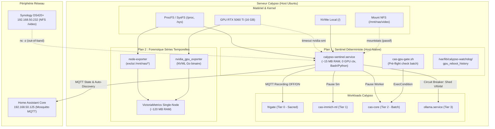

# Plan d'Architecture & Implémentation — Sentinel & Monitoring Calypso

> **Statut** : Approuvé pour implémentation  
> **Date** : 2026-10-27  
> **Auteur** : Antigravity (d'après les recommandations architecturales de Gemini Argon)  
> **Cible** : Serveur Calypso (Ubuntu 24.04, RTX 5060 Ti 16 GB, NVMe local, Synology NAS `192.168.50.232`, Home Assistant `192.168.50.125`)  
> **Évolution de** : [`gpu-shared-management.md`](./gpu-shared-management.md)

---

## 1. Contexte & Vision Architecturale

Calypso opère en tant que nœud unique critique hébergeant des charges de travail hétérogènes :
* **Temps réel / Sacré (P1)** : `frigate` (détection TensorRT sur RTX 5060 Ti, enregistrement vidéo continu sur NAS Synology).
* **Services interactifs utilisateurs (P2)** : `cas-immich-server` (NVENC) & `cas-immich-ml` (embeddings CLIP).
* **Pipelines batch d'enrichissement (P2/P3)** : `cas-core` (WhisperX, Demucs, Surya OCR).
* **Inférence locale LLM à la demande (P3)** : `ollama.service`.

### 1.1 Révocation de la pile lourde (Prometheus / Grafana / DCGM)

Le plan préliminaire (`gpu-shared-management.md`) envisageait une pile standard Prometheus + Grafana + cAdvisor + NVIDIA DCGM. L'analyse architecturale démontre que cette approche est contre-productive sur un serveur bare-metal unique à ressources partagées :
1. **Empreinte mémoire et I/O prohibitive** : Une telle suite consomme entre 1.5 et 2.5 GB de RAM et génère des écritures TSDB permanentes sur le NVMe.
2. **Support GeForce incomplet** : DCGM est conçu pour les GPU Datacenter (A100/H100) ; sur architecture GeForce (GB206 / RTX 5060 Ti), les métriques avancées (profiling hardware, MIG) sont absentes et le démon résiduel introduit un overhead inutile.
3. **Dépendance circulaire de monitoring** : Si le démon Docker sature ou si un verrou kernel survient, le système de monitoring conteneurisé gèle avec les charges qu'il est censé surveiller.

### 1.2 Architecture retenue : Dual-Plane Telemetry & Control

Nous déployons une architecture à double plan découplée :



* **Plan 1 (Sentinel Déterministe en boucle rapide)** : Démon host sous systemd (`calypso-sentinel.service`), résidant en RAM (~15 MB), sans contexte GPU, indépendant du démon Docker et insensible aux blocages NFS. Il applique les disjoncteurs (circuit breakers) et publie l'état vers Home Assistant via MQTT.
* **Plan 2 (Magasin de métriques léger pour analyse forensique)** : Instance VictoriaMetrics mono-nœud avec `node-exporter` et `nvidia_gpu_exporter` (Go binary). Empreinte mémoire globale plafonnée à ~120 MB (gain de 7x par rapport à Prometheus).

---

## 2. Matrice des Métriques, Sondes & Seuils du Sentinel

Toutes les sondes du Sentinel doivent être **strictement non-bloquantes** (timeouts matériels et lecture procfs virtuelle).

| Sous-système | Métrique / Signal | Méthode de sonde (Non-bloquante) | Seuil Avertissement (P2 - Dégradé) | Seuil Critique (P1 - Action / Disjoncteur) |
|---|---|---|---|---|
| **Host & Kernel** | Processus en sommeil ininterruptible (`D`-state) | Scan `/proc/[0-9]*/stat` champ d'état | $> 2$ procs pendant $> 60\,\text{s}$ | $> 5$ procs pendant $> 120\,\text{s}$ |
| **Host & Kernel** | Linux Pressure Stall Info (PSI) | Lecture `/proc/pressure/{memory,io,cpu}` | `io.full.avg60` $> 15\%$ | `memory.full.avg60` $> 25\%$ |
| **Host & Kernel** | Churn du Swap (`pswpin`, `pswpout`) | Delta `/proc/vmstat` | $> 50\,\text{pages/s}$ pdt $5\,\text{min}$ | $> 250\,\text{pages/s}$ ou Swap libre $< 2\,\text{GB}$ |
| **Stockage NVMe** | Capacité racine `/` et Inodes | `stat -f -c "%a %b" /` | $< 15\%$ libre ($< 70\,\text{GB}$) | $< 8\%$ libre ($< 37\,\text{GB}$) |
| **Stockage NVMe** | Usure SMART & Erreurs médias | `nvme smart-log /dev/nvme0n1 -o json` | `percentage_used` $> 80\%$ | `media_errors` $> 0$ ou `critical_warning` $> 0$ |
| **GPU RTX 5060 Ti** | VRAM globale disponible | `nvidia-smi --query-gpu=memory.free` | $< 2\,500\,\text{MiB}$ libre | $< 1\,200\,\text{MiB}$ libre |
| **GPU RTX 5060 Ti** | Réactivité de l'API Driver | `timeout -k 2 3s nvidia-smi -L` | Latence $> 800\,\text{ms}$ | Code sortie `124` (Timeout / Bus gelé) |
| **GPU RTX 5060 Ti** | Classification des erreurs Xid | `journalctl -k -g "NVRM: Xid"` | Xid applicatif (soft) : `13, 31, 43, 45, 68` | Xid Bus/MMU fatal : `48, 79, 92, 119, 154` |
| **GPU RTX 5060 Ti** | Throttling thermique et électrique | `nvidia-smi --query-gpu=temperature.gpu,clocks_event_reasons.active` | Temp $> 78^\circ\text{C}$ ou Slowdown SW | Temp $> 85^\circ\text{C}$ ou Slowdown HW bitmask |
| **NFS (`.232`)** | Disponibilité RPC & Point de montage | `nc -z -w 1 192.168.50.232 2049` + `rpcinfo -t` + `/proc/self/mountstats` | RTT RPC $> 150\,\text{ms}$ ou Retransmits $> 5$ | Timeout TCP/RPC ($> 2\,\text{s}$) ou Stale File Handle |
| **Databases (CAS)** | Taille WAL SQLite & Contention verrous | Taille `*.sqlite-wal` sur NVMe ; `fuser` | `*.sqlite-wal` $> 256\,\text{MB}$ | Verrou écriture continu $> 120\,\text{s}$ |
| **Databases (Immich)** | Santé PostgreSQL & `vectorchord` | `pg_isready` + `pg_stat_activity` (idle in tx) | Verrous actifs $> 30\,\text{s}$ | Connexion refusée ou corruption index |
| **Databases (Immich)** | Intégrité Valkey BGSAVE | `valkey-cli INFO persistence` | `rdb_changes_since_last_save` $> 10000$ | `rdb_last_bgsave_status != ok` |
| **Workloads** | Boucle de redémarrage & OOM | `docker inspect` (`RestartCount`, `OOMKilled`) | $\Delta\text{Restarts} \ge 1$ en $15\,\text{min}$ | `OOMKilled == true` ou $\ge 3$ restarts en $10\,\text{min}$ |
| **Workloads** | Frigate Core vs Flux Caméras | `GET http://127.0.0.1:5000/api/stats` | Une caméra isolée `camera_fps == 0` | Détecteur ONNX PID mort ou API timeout |
| **Sauvegardes** | Fraîcheur Snapshot Restic & Verrous | Inspect `/home/nghia-phan/restic/status.json` + `locks/` | Âge dernier snapshot $> 28\,\text{h}$ | Verrou résiduel $> 6\,\text{h}$ ou code sortie $\ne 0$ |

---

## 3. Garde-fous Automatisés & Disjoncteurs (Circuit Breakers)

### Garde-fou A : Arbitre de Priorité GPU & Délestage Dynamique VRAM

Sur GPU grand public (sans support MIG matériel), les allocations CUDA concurrentes ne préemptent pas la mémoire dynamiquement : une surallocation produit un crash fatal `CUDA_ERROR_OUT_OF_MEMORY`. L'arbitre impose une hiérarchie stricte à 4 niveaux :
* **Tier 0 (Sacré / Temps réel)** : `frigate` (base ~2.2 GB, pics ~3.2 GB). Strictement protégé.
* **Tier 1 (Interactif Utilisateur)** : `cas-immich-server` (NVENC) & `cas-immich-ml` (~1.5–3.0 GB).
* **Tier 2 (Batch d'arrière-plan)** : `cas-core` (WhisperX, Demucs, OCR).
* **Tier 3 (LLM à la demande)** : `ollama.service`.

#### Mécanismes d'implémentation :
1. **Plafonnement strict d'Ollama (`ollama.service`)** :
   ```ini
   [Service]
   Environment="OLLAMA_KEEP_ALIVE=5m"
   Environment="OLLAMA_MAX_LOADED_MODELS=1"
   Environment="OLLAMA_NUM_PARALLEL=1"
   ```
2. **Portier VRAM Pré-Flight (`/usr/local/bin/cas-gpu-gate.sh`)** :
   Invoqué avant tout timer batch lourd (`cas-core`) :
   * Vérifie que la VRAM libre est $\ge 4\,500\,\text{MiB}$ et que la température est $\le 76^\circ\text{C}$.
   * Si la mémoire est insuffisante mais occupée par Ollama, envoie instantanément une requête d'éviction :
     ```bash
     curl -s -X POST http://127.0.0.1:11434/api/generate -d '{"model": "...", "keep_alive": 0}'
     ```
   * Si les conditions ne sont toujours pas réunies, le script sort avec code `0` (run proprement ignoré sans lever d'échec systemd).
3. **Délestage Actif dans le Sentinel (`calypso-sentinel`)** :
   * **Seuil Souple (VRAM libre $< 2\,000\,\text{MiB}$)** :
     1. Éjection immédiate des modèles Ollama (`keep_alive: 0`).
     2. Si après $10\,\text{s}$ la VRAM reste $< 2\,000\,\text{MiB}$, suspension du worker batch :
        `docker exec cas-core supervisorctl stop gpu-worker` (laisse l'UI et les webhooks CAS actifs).
   * **Seuil Dur (VRAM libre $< 800\,\text{MiB}$)** :
     Mise en pause temporaire de `cas-immich-ml` (`docker pause cas-immich-ml` pour $5\,\text{min}$) afin de garantir l'intégrité du détecteur Frigate TensorRT.

---

### Garde-fou B : Triage des Erreurs Xid & Protection Anti-Boucle de Reboot

Sur erreur GPU, l'appel aveugle à `nvidia-smi -r` ou `modprobe -r nvidia` bloque le kernel en `D`-state si des descripteurs de fichiers `/dev/nvidia*` sont ouverts. De même, un redémarrage hôte automatique sans limite peut créer une boucle infinie de boot.

* **Classe 1 : Erreurs Applicatives / Contexte Soft (Xid 13, 31, 43, 45, 68)** :
  * *Diagnostic* : Erreur de calcul ou accès mémoire hors bornes confiné à un conteneur (`cas-core` ou `cas-immich-ml`). Le silicium et le driver restent sains.
  * *Action* : Extraction du PID fautif depuis le journal kernel (`NVRM: Xid ... pid=XXXX`), identification du conteneur via `/proc/XXXX/cgroup`, redémarrage du conteneur incriminé uniquement, émission d'une alerte **P2** vers Home Assistant.
* **Classe 2 : Erreurs Fatales Bus / Détachement PCIe (Xid 48, 79, 92, 119, 154)** :
  * *Diagnostic* : GPU tombé du bus PCIe ou blocage interne GSP firmware.
  * *Action* :
    1. Toutes les invocations de `nvidia-smi` sont impérativement encadrées par `timeout --kill-after=2s 4s nvidia-smi`.
    2. Ne jamais exécuter `modprobe -r nvidia`.
    3. Publication immédiate d'un message MQTT retained critique **P1** vers Home Assistant (`calypso/gpu/status = FATAL_XID_79`).
    4. Synchronisation des systèmes de fichiers NVMe (`sync`).
    5. **Garde-fou Anti-Boot-Loop** : Consultation du fichier persistant `/var/lib/calypso-watchdog/gpu_reboot_history`. Redémarrage matériel ordonné uniquement si **0 redémarrage dans les 6 dernières heures**. Si un reboot est déjà intervenu dans cette fenêtre, désactivation de l'autostart GPU, maintien du serveur en mode dégradé CPU/SSH et notification d'urgence vers Home Assistant.

---

### Garde-fou C : Isolation des Pannes NFS & Protection contre le `D`-State

Lors d'un redémarrage ou d'une perte réseau du NAS Synology (`192.168.50.232`), l'option par défaut `hard` provoque un blocage permanent des processus `ffmpeg` et de tout outil de probing (`df`, `stat /mnt/nas/video`) en sommeil ininterruptible (`D`-state).

1. **Interdiction Formelle des Sondes Bloquantes** :
   * Aucun appel à `stat` ou `df` sur `/mnt/nas/video`.
   * Vérification réseau hors-bande préalable : `nc -z -w 1 192.168.50.232 2049` puis `rpcinfo -t 192.168.50.232 nfs 4`.
   * Analyse passive de la santé NFS via `/proc/self/mountstats` (fichier procfs virtuel non-bloquant).
2. **Transition de `mnt-nas-video.mount` vers Automount avec Options Durcies** :
   Remplacement de la configuration `hard,timeo=600` par :
   ```ini
   Options=nfsvers=4.1,proto=tcp,soft,timeo=150,retrans=3,actimeo=30,noatime,x-systemd.automount,x-systemd.idle-timeout=0,_netdev
   ```
   * *Rationale* : La base de données Frigate (`frigate.db`) réside sur le **NVMe local** ; seuls les segments MP4 bruts transitent vers le NAS. L'option `soft` avec `timeo=150` (15 secondes, 3 retransmissions) garantit que si le NAS est indisponible plus de 45 secondes, `ffmpeg` reçoit un `-EIO` et ignore le segment vidéo au lieu de bloquer le noyau Linux en `D`-state.
3. **Disjoncteur Actif pour l'Enregistrement Frigate** :
   Si le port NFS (2049) ne répond pas pendant 30 secondes consécutives :
   * Le Sentinel publie via MQTT : `frigate/recordings/set = OFF`.
   * Frigate suspend les écritures sur disque distant tout en maintenant active la détection d'objets en RAM (`tmpfs` de 2 GB) et l'émission des snapshots.
   * Dès rétablissement du NAS, le Sentinel réactive l'enregistrement : `frigate/recordings/set = ON`.

---

### Garde-fou D : Découplage des Timers Systemd & Conteneurs (`cas-*`)

Avec une quinzaine de timers hôtes exécutant des commandes au sein des conteneurs, un conteneur gelé entraîne l'accumulation indésirable de processus `docker exec`.

1. **Durcissement des Units Systemd** :
   * Ajout systématique de `TimeoutStartSec=300s` (ou `25s` pour les timers fréquents).
   * Verrouillage anti-chevauchement via `flock -n /run/lock/cas-job-<name>.lock` dans `ExecStart`.
2. **Vérification Pré-Flight (`ExecCondition`)** :
   Ajout de `ExecCondition=/usr/local/bin/cas-container-ready.sh` dans chaque unit `cas-*.service`. Ce script valide en $< 50\,\text{ms}$ :
   * L'état de santé du conteneur : `docker inspect -f '{{.State.Health.Status}}' cas-core` == `healthy`.
   * La charge globale du système : `loadavg 1m < 12.0`.
   * La taille maîtrisée des fichiers `-wal` SQLite.
   * En cas de non-respect, `ExecCondition` renvoie le code `1` : systemd consigne un saut propre (`ConditionResult=no`) au lieu d'un échec en boucle.

---

### Garde-fou E : Découplage du Healthcheck Frigate

La configuration précédente utilisait la détection de FPS sur la caméra Wi-Fi extérieure `allee_sur_le_cote` pour juger de la santé du moteur Frigate. Une intempérie ou une coupure Wi-Fi provoquait le redémarrage intempestif de tout le serveur Frigate, aveuglant les autres caméras.

1. **Healthcheck Conteneur Découplé (Moteur uniquement)** :
   Mise à jour du healthcheck dans `frigate/docker-compose.calypso.yml` :
   ```yaml
   healthcheck:
     test: ["CMD-SHELL", "curl -sf http://127.0.0.1:5000/api/stats | jq -e '(.detectors.onnx1.pid > 0) and (.service.uptime > 0)'"]
     interval: 30s
     timeout: 10s
     retries: 3
     start_period: 240s
   ```
2. **Surveillance des Caméras Isolées déportée vers Home Assistant** :
   L'intégration Home Assistant Frigate assure le suivi individuel de l'entité `camera_fps`. Si `allee_sur_le_cote` tombe à 0 FPS pendant plus de 5 minutes, Home Assistant déclenche une notification P2 ou cycle une prise connectée sans impacter le conteneur Frigate.

---

## 4. Stratégie d'Alerte & Intégration Home Assistant

Toutes les métriques convergent vers le broker Mosquitto de Home Assistant (`192.168.50.125`) via le protocole **MQTT Auto-Discovery**, instanciant un unique device centralisé : **`Calypso Server Sentinel`**.

### 4.1 Hiérarchie des Sévérités

| Niveau | Désignation | Déclencheurs sur Calypso | Action Automatisée & Routage |
|---|---|---|---|
| **P3** | **Informationnel / Auto-Réparé** | • VRAM Ollama évincée pour laisser passer un job `cas-core`<br>• Erreur Xid soft (13/31) auto-résolue par restart conteneur<br>• Timer `cas-*` ignoré pour charge système élevée<br>• Docker prune / NVMe trim ayant libéré $> 10\,\text{GB}$ | • Enregistré dans le journal local & VictoriaMetrics<br>• Mise à jour des attributs du capteur de diagnostic HA<br>• **Aucune notification push** (protection contre la fatigue d'alerte) |
| **P2** | **Dégradé / Action Requise** | • Caméra isolée hors ligne $> 5\,\text{min}$<br>• Espace libre NVMe $< 15\%$ ($< 70\,\text{GB}$)<br>• Échec de sauvegarde Valkey (`rdb_last_bgsave_status != ok`)<br>• Sauvegarde Restic manquante ($> 28\,\text{h}$) ou verrou orphelin<br>• Fichier SQLite WAL $> 256\,\text{MB}$ ou swap $> 4\,\text{GB}$ | • Notification persistante sur le Dashboard Home Assistant<br>• Notification push mobile standard (`importance: default`) |
| **P1** | **Critique / Immédiat** | • Erreur Xid matérielle fatale (79/154) ou timeout `nvidia-smi`<br>• Point de montage NFS unreachable $> 60\,\text{s}$ (recordings Frigate coupés)<br>• Processus en `D`-state kernel $> 5$ pendant $> 2\,\text{min}$<br>• Détecteur TensorRT Frigate mort ou conteneur OOM-killed | • Déclenchement immédiat des disjoncteurs matériels/logiciels<br>• Notification push d'urgence critique sur iPhone (`push.sound.critical: 1`, contourne le mode Ne Pas Déranger) |

### 4.2 Schéma du Payload d'État MQTT

Le Sentinel publie l'état consolidé toutes les 60 secondes sur le topic `calypso/sentinel/state` (avec `expire_after: 180` en dead-man's switch) :

```json
{
  "status": "HEALTHY",
  "severity": "P3",
  "gpu": {
    "vram_used_mib": 2410,
    "vram_free_mib": 13901,
    "temp_c": 54,
    "xid_fatal_count": 0,
    "xid_soft_count": 0,
    "throttled_workers": false
  },
  "storage": {
    "nvme_free_gb": 344.2,
    "nvme_used_pct": 23.1,
    "nfs_video_online": true,
    "nfs_rtt_ms": 1.4
  },
  "kernel": {
    "load_1m": 1.85,
    "d_state_procs": 0,
    "oom_kills_24h": 0,
    "swap_used_gib": 2.4
  },
  "workloads": {
    "frigate_detector_alive": true,
    "offline_cameras": [],
    "cas_core_healthy": true,
    "valkey_bgsave_ok": true,
    "restic_last_age_hours": 3.7
  }
}
```

---

## 5. Feuille de Route d'Implémentation par Phases

### Phase 1 : Stabilisation Immédiate & Gains Rapides (Aucun nouveau démon)

1. **Découplage du Healthcheck Frigate** : Remplacer dans `frigate/docker-compose.calypso.yml` le test basé sur `allee_sur_le_cote` par la vérification du PID détecteur ONNX et de l'uptime du service.
2. **Garde-fous des Journaux Docker & Tmpfs** : Configurer `/etc/docker/daemon.json` avec `"log-driver": "json-file"` et `"log-opts": {"max-size": "50m", "max-file": "3"}` afin de protéger le NVMe de 500 GB contre tout débordement de log.
3. **Durcissement des Paramètres Ollama & Systemd `cas-*`** :
   * Appliquer `OLLAMA_KEEP_ALIVE=5m`, `OLLAMA_MAX_LOADED_MODELS=1`, `OLLAMA_NUM_PARALLEL=1` dans `frigate/gpu/systemd/ollama.service`.
   * Déployer le script portier `cas-container-ready.sh` et ajouter `ExecCondition=` et `TimeoutStartSec=` sur les services `cas-*`.
4. **Sécurisation du Point de Montage NFS (`/mnt/nas/video`)** :
   Mettre à jour `/etc/systemd/system/mnt-nas-video.mount` avec `soft,timeo=150,retrans=3` et activer `mnt-nas-video.automount`.

### Phase 2 : Évolution du Sentinel Hôte & Disjoncteurs Actifs

1. **Remplacement de `gpu-watchdog.sh` par `calypso-sentinel.sh`** :
   * Intégrer les wrappers `timeout -k 2 4s` sur tous les appels NVML/`nvidia-smi`.
   * Intégrer l'arbitre de VRAM hiérarchisé (Ollama éviction $\rightarrow$ worker batch pause $\rightarrow$ `cas-immich-ml` pause).
   * Implémenter le contrôle NFS hors-bande avec coupure/reprise de l'enregistrement Frigate via MQTT.
   * Ajouter la vérification du statut Restic (`/home/nghia-phan/restic/status.json`), de Valkey BGSAVE et des fichiers SQLite WAL.
   * Déployer la protection anti-boucle de reboot (`/var/lib/calypso-watchdog/gpu_reboot_history`).
2. **Déploiement de l'Auto-Discovery MQTT pour Home Assistant** :
   Publier la déclaration automatique des capteurs `calypso_sentinel` vers `192.168.50.125`.

### Phase 3 : Forensique Séries Temporelles Ultra-Légère & Routage des Alertes

1. **Remplacement de la pile Prometheus/DCGM par VictoriaMetrics** :
   * Déployer dans `frigate/gpu/monitoring/docker-compose.monitoring.yml` :
     * `victoriametrics/victoria-metrics:v1.103.0` (mono-binaire, limite RAM `256m`).
     * `prom/node-exporter:v1.8.2` (avec `--collector.filesystem.mount-points-exclude="^/mnt/nas/.*"`).
     * `utkuozdemir/nvidia_gpu_exporter:1.3.1` (binaire Go NVML léger).
     * `cadvisor` optimisé via `docker-socket-proxy` (`--housekeeping_interval=30s --docker_only=true`).
2. **Configuration des Automations d'Alerte Home Assistant** :
   Configurer les règles d'alerte basées sur `sensor.calypso_sentinel_severity` (P1 $\rightarrow$ push critique DND override, P2 $\rightarrow$ notification persistante dashboard).

---

## 6. Protocole de Validation & Tests de Non-Régression

| Scénario de Test | Procédure de Test | Résultat Attendu |
|---|---|---|
| **Test 1 : Concurrence VRAM & Éviction Ollama** | Charger un modèle volumineux dans Ollama (`curl ... /api/generate`), puis lancer manuellement `cas-gpu-gate.sh`. | Ollama décharge son modèle instantanément (`keep_alive: 0`) ; la VRAM repasse $\ge 4.5\,\text{GB}$ sans impacter Frigate. |
| **Test 2 : Simulation Déconnexion NFS** | Bloquer temporairement le port 2049 via iptables locale : `iptables -A OUTPUT -p tcp -d 192.168.50.232 --dport 2049 -j DROP`. | Le Sentinel détecte l'indisponibilité sous 30s ; publication MQTT `frigate/recordings/set=OFF` ; Frigate continue la détection locale sans bloquer le kernel en `D`-state. Rétablissement immédiat au retrait de la règle. |
| **Test 3 : Simulation Erreur Wi-Fi Caméra** | Couper temporairement le flux d'une caméra isolée (`allee_sur_le_cote`). | Le conteneur Frigate reste `healthy` (PID détecteur ONNX actif) ; Home Assistant lève une alerte P2 dédiée à la caméra sans redémarrage de Frigate. |
| **Test 4 : Résilience API GPU (Timeout)** | Simuler un retard driver via script mocké ou charge extrême. | Les sondes du Sentinel n'excèdent jamais 4 secondes de timeout ; aucun blocage résiduel dans systemd. |
