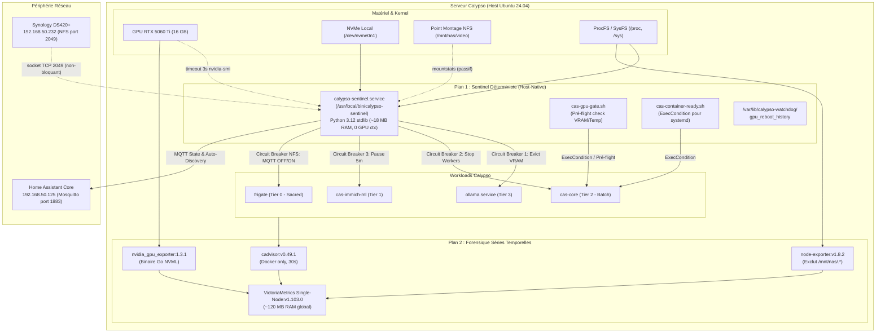

# Plan d'Architecture & d'Implémentation Durci — Sentinel & Monitoring Calypso

> **Statut** : Prêt pour implémentation autonome par Agent IA (Roo Code / MiniMax M3)  
> **Date de durcissement** : 2026-10-27  
> **Cible matérielle** : Serveur Calypso (Ubuntu 24.04.1 LTS, Kernel Linux 6.8+, NVIDIA RTX 5060 Ti 16 GB Blackwell SM 120, Driver 570+, NVMe local `/dev/nvme0n1`, Docker Engine 27.x, Synology NAS DS420+ `192.168.50.232`, Home Assistant Core / Mosquitto `192.168.50.125`)  
> **Dépôt de référence** : `/home/nghia-phan/AGENTIC_DEVELOPMENT_PROJECTS/APPLICATION-PROJECTS/frigate`  
> **Évolution formelle de** : `plans/gpu-shared-management.md` & `plans/calypso-sentinel-health-monitoring-plan.md`

---

## Directives d'Exécution pour le Développeur IA (Roo Code / MiniMax M3)

1. **Zéro supposition / Zéro placeholder** : Ce document fournit l'intégralité des configurations et des scripts sans points de suspension (`...`) ni variables non définies. Tout bloc de configuration ou de code doit être copié-collé rigoureusement.
2. **Ordre strict des phases** : Vous devez exécuter les phases séquentiellement (Phase 0 → Phase 1 → Phase 2 → Phase 3 → Phase 4). Aucune phase ne doit être sautée.
3. **Validation obligatoire à chaque étape** : Chaque action est immédiatement suivie d'une commande de validation. Si le résultat attendu n'est pas obtenu, interrompez la progression et appliquez le rollback spécifié.
4. **Intégrité de Docker & NVIDIA Runtime** : Lors de la modification de `/etc/docker/daemon.json`, le runtime `nvidia` existant **ne doit en aucun cas être supprimé** ; le durcissement des logs s'effectue par fusion JSON. **Attention** : `systemctl reload docker` requiert le mot de passe root — utiliser `systemctl restart docker` qui lui est dans les droits `sudo` sans mot de passe du sudoers. Le restart Docker ne tue pas les conteneurs déjà démarrés.
5. **Gestion des privilèges** : Le démon Sentinel et les units systemd s'exécutent en tant que `root`. Les scripts appelés par Roo Code depuis le shell hôte exploitent le wrapper `sudo` sans mot de passe configuré via `/etc/sudoers.d/nghia-phan-gpu`.
6. **Emplacements sources dans le dépôt** : Tous les nouveaux scripts sont d'abord écrits dans le dépôt (`gpu/` ou `gpu/systemd/`), puis installés via `sudo install ...`. Ne jamais passer une source identique à la destination (ex: `install /usr/local/bin/X /usr/local/bin/X` est une erreur).
7. **Réseau inter-conteneurs Docker** : `victoria-metrics` (conteneur) ne peut pas atteindre `127.0.0.1` de l'hôte. Utiliser `extra_hosts: ["host-gateway:host-gateway"]` et cibler `host-gateway:9100` dans `scrape.yml`.

---

## 1. Contexte & Architecture Dual-Plane Découplée

Calypso consolide quatre niveaux de criticité sur un GPU grand public RTX 5060 Ti 16 GB dépourvu de partitionnement MIG matériel :
* **Tier 0 (Temps réel / Sacré)** : `frigate` (détection TensorRT SM120, flux vidéo continu vers NAS Synology). Ne doit jamais perdre de frames ni être redémarré intempestivement.
* **Tier 1 (Interactif Utilisateur)** : `cas-immich-server` (NVENC) & `cas-immich-ml` (embeddings CLIP).
* **Tier 2 (Batch d'arrière-plan)** : `cas-core` (workers Document/Visual/Vector, WhisperX, Demucs).
* **Tier 3 (LLM à la demande)** : `ollama.service` (serveur local).



---

## 2. Matrice Exhaustive des Sondes, Méthodes & Seuils

| ID | Sous-système | Signal Surveillé | Méthode Exacte Non-Bloquante | Seuil P2 (Dégradé / Warn) | Seuil P1 (Critique / Disjoncteur) | Action Automatisée |
|---|---|---|---|---|---|---|
| **S01** | Kernel | Processus en D-state | Scan `/proc/[0-9]*/stat` (champ 3 == `'D'`) | $> 2$ procs pendant $> 60\,\text{s}$ | $> 5$ procs pendant $> 120\,\text{s}$ | Notification HA P1/P2 ; traçabilité des PID et noms de commande |
| **S02** | Kernel | Pressure Stall Info (PSI) | Lecture `/proc/pressure/{io,memory,cpu}` | `io.full.avg60 > 15.0` | `memory.full.avg60 > 25.0` | Notification P2, inhibition des lancements de batchs CAS |
| **S03** | Kernel | Churn Swap | Delta `/proc/vmstat` (`pswpin` + `pswpout`) | $> 50\,\text{pages/s}$ pdt $5\,\text{min}$ | $> 250\,\text{pages/s}$ OU swap libre $< 2.0\,\text{GB}$ | Arrêt temporaire des workers d'indexation CAS |
| **S04** | NVMe | Espace racine `/` | `os.statvfs('/')` | Espace libre $< 15\%$ ($< 70\,\text{GB}$) | Espace libre $< 8\%$ ($< 37\,\text{GB}$) | Docker prune ciblé (images orphelines, build cache) |
| **S05** | NVMe | Santé SMART | `timeout 3s nvme smart-log /dev/nvme0n1 -o json` | `percentage_used > 80%` | `media_errors > 0` OU `critical_warning > 0` | Alerte critique P1 immédiate vers Home Assistant |
| **S06** | GPU | VRAM Disponible | `timeout 4s nvidia-smi --query-gpu=memory.free` | VRAM libre $< 2\,500\,\text{MiB}$ | VRAM libre $< 1\,200\,\text{MiB}$ | Éviction Ollama à $< 2\,000\,\text{MiB}$ ; pause `cas-immich-ml` à $< 800\,\text{MiB}$ |
| **S07** | GPU | Réactivité Driver | `timeout -k 2 4s nvidia-smi -L` | Latence $> 1\,000\,\text{ms}$ | Code retour `124` (Timeout / Bus gelé) | Traitement en Classe Xid 2 (Panne fatale bus) |
| **S08** | GPU | Erreurs Kernel Xid | `journalctl -k -b 0 -g "NVRM: Xid"` | Xid Soft : `13, 31, 43, 45, 68` | Xid Fatal : `48, 79, 92, 119, 154` | Soft : redémarrage conteneur ciblé via cgroup. Fatal : sync + reboot sécurisé |
| **S09** | GPU | Température | `timeout 4s nvidia-smi --query-gpu=temperature.gpu` | Température $> 78^\circ\text{C}$ | Température $> 85^\circ\text{C}$ | Pause temporaire des batchs CAS et Immich ML |
| **S10** | NFS | Connectivité NAS | `socket.create_connection(('192.168.50.232', 2049), 1.0)` | Port fermé ou timeout $> 1\,000\,\text{ms}$ | Indisponibilité consécutive $\ge 30\,\text{s}$ | Disjoncteur Frigate : bascule `frigate/<cam>/recordings/set = OFF` |
| **S11** | NFS | Saturation RPC | Lecture passive `/proc/self/mountstats` | `retrans > 10` en $60\,\text{s}$ | Montage en Stale I/O | Alerte P2 vers HA |
| **S12** | Workload | Santé Core Frigate | `GET http://127.0.0.1:5000/api/stats` | `onnx1.pid` manquant ou API timeout $> 3\,\text{s}$ | Conteneur Frigate crashé ou OOM-killed | Alerte critique P1, redémarrage conteneur Frigate |
| **S13** | Workload | Immich Postgres | `docker exec cas-immich-database pg_isready -U immich -d immich` | Transactions idle $> 30\,\text{s}$ | Connexion refusée | Alerte P2 |
| **S14** | Workload | Immich Valkey | `docker exec cas-immich-redis valkey-cli INFO persistence` | `rdb_changes_since_last_save > 10000` | `rdb_last_bgsave_status != ok` | Alerte P2 |
| **S15** | Workload | CAS SQLite WAL | Glob `/home/nghia-phan/.../local_ssd/vault/index/*.db-wal` | Somme des WAL $> 256\,\text{MB}$ | Fichier WAL verrouillé en écriture $> 120\,\text{s}$ | Pause des batchs CAS pour forcer le checkpoint WAL |
| **S16** | Backup | Fraîcheur Restic | Lecture `/home/nghia-phan/restic/status.json` | Âge snapshot $> 28\,\text{h}$ | Verrou `/tmp/restic_calypso_backup.lock` $> 6\,\text{h}$ | Alerte P2 vers HA |

---

## 3. Disjoncteurs Automatisés (Circuit Breakers)

### 3.1 Disjoncteur A : Arbitrage VRAM Hiérarchisé
Sur architecture GeForce RTX 5060 Ti, tout dépassement VRAM provoque un crash immédiat sans swap GPU. L'arbitre Sentinel applique la cascade suivante :
1. **Étage 1 — Seuil Souple (VRAM libre $< 2\,000\,\text{MiB}$)** :
   * Requête d'inspection Ollama : `GET http://127.0.0.1:11434/api/ps`.
   * Pour chaque modèle renvoyé dans `.models[].name`, exécution immédiate :
     ```bash
     curl -s -X POST http://127.0.0.1:11434/api/generate -d '{"model": "'"$model"'", "keep_alive": 0}'
     ```
   * Temporisation passive de 10 secondes.
   * Si la VRAM libre reste $< 2\,000\,\text{MiB}$, suspension des workers d'arrière-plan CAS :
     ```bash
     docker exec cas-core supervisorctl -c /app/docker/cas-core/supervisord.conf stop cas-visual-worker cas-vector-worker
     ```
   * Enregistrement de l'état : `cas_workers_paused = True`.
2. **Étage 2 — Seuil Dur (VRAM libre $< 800\,\text{MiB}$)** :
   * Mise en pause du conteneur ML utilisateur :
     ```bash
     docker pause cas-immich-ml
     ```
   * Enregistrement du timestamp : `immich_ml_paused_at = now()`.
   * Émission d'une alerte critique **P1** vers Home Assistant.
3. **Réarmement Automatique** :
   * Si `immich_ml_paused_at` est actif et (`now() - immich_ml_paused_at >= 300` OU `vram_free >= 4000 MiB`) :
     ```bash
     docker unpause cas-immich-ml
     ```
   * Si `cas_workers_paused` est actif et `vram_free >= 4000 MiB` :
     ```bash
     docker exec cas-core supervisorctl -c /app/docker/cas-core/supervisord.conf start cas-visual-worker cas-vector-worker
     ```

### 3.2 Disjoncteur B : Triage Xid & Protection Anti-Boucle de Redémarrage
* **Classe 1 (Xid Soft : 13, 31, 43, 45, 68)** :
  * Extraction du PID responsable depuis le journal kernel : regex `pid=([0-9]+)`.
  * Identification du conteneur associé via `/proc/<pid>/cgroup` (lecture du slice `docker-<id>.scope`).
  * Redémarrage ciblé du conteneur Docker uniquement.
  * Publication d'un événement **P2** dans Home Assistant sans rebooter l'hôte.
* **Classe 2 (Xid Fatal : 48, 79, 92, 119, 154 ou Timeout `nvidia-smi`)** :
  * **Interdiction absolue** d'exécuter `rmmod nvidia` ou `modprobe -r nvidia` (risque immédiat de gel kernel).
  * Publication retained P1 immédiate : `calypso/sentinel/state` avec `"status": "FATAL_GPU_WEDGED"`.
  * Exécution synchrone des écritures NVMe : `/bin/sync`.
  * Consultation du fichier persistant `/var/lib/calypso-watchdog/gpu_reboot_history` :
    * Lecture des timestamps des redémarrages sur les 6 dernières heures (21 600 secondes).
    * **Si 0 redémarrage dans la fenêtre** :
      * Enregistrement du timestamp actuel dans `/var/lib/calypso-watchdog/gpu_reboot_history`.
      * Déclenchement d'un redémarrage matériel propre : `/sbin/reboot`.
    * **Si $\ge 1$ redémarrage récent détecté** :
      * Déclenchement du **Garde-fou Anti-Boot-Loop** : interdiction formelle de rebooter.
      * Création du fichier drapeau `/run/calypso-gpu-halt`.
      * Maintien du serveur en ligne en mode dégradé (SSH, services CPU) et notification d'urgence P1 vers Home Assistant.

### 3.3 Disjoncteur C : Isolation Panne NFS (`192.168.50.232`) & Découplage Frigate
* Frigate stocke sa base de métadonnées SQLite (`frigate.db`) sur le NVMe local. Seuls les fichiers vidéos MP4 sont écrits sur le montage NFS `/mnt/nas/video`.
* Si la sonde TCP sur le port 2049 du NAS échoue pendant $\ge 30\,\text{s}$ consécutives :
  1. Le Sentinel bascule la variable d'état `nfs_tripped = True`.
  2. Pour chacune des 8 caméras configurées (`allee_sur_le_cote`, `buro`, `cuisine`, `jardin_arriere`, `jardin_devant`, `piscine_vue_toit`, `salon`, `vue_entree`), publication MQTT de suspension d'enregistrement :
     ```bash
     mosquitto_pub -h 192.168.50.125 -u mosquitto -P mosquitto -t "frigate/<cam>/recordings/set" -m "OFF"
     ```
  3. Frigate cesse toute écriture vers `/mnt/nas/video` et maintient sa détection temps réel en RAM (`/tmp/cache` sur tmpfs de 2 GB).
  4. Dès que la sonde TCP 2049 redevient saine pendant 10 secondes consécutives :
     * Le Sentinel réactive l'enregistrement sur toutes les caméras via MQTT :
       ```bash
       mosquitto_pub -h 192.168.50.125 -u mosquitto -P mosquitto -t "frigate/<cam>/recordings/set" -m "ON"
       ```
     * Réinitialisation de `nfs_tripped = False` et émission d'un événement de rétablissement P3.

---

## 4. Spécifications Techniques & Code Source Intégral

### 4.1 Script Portier Conteneurs : `/usr/local/bin/cas-container-ready.sh`
Ce script sert d'`ExecCondition=` pour les services batch systemd. Il vérifie en $< 50\,\text{ms}$ la santé du conteneur cible, la charge de l'hôte et la taille des WAL.
* **Code retour `0`** : Conditions réunies $\rightarrow$ systemd exécute le service.
* **Code retour `1`** : Condition non satisfaite $\rightarrow$ systemd consigne `ConditionResult=no` et saute l'exécution sans marquer d'erreur.

```bash
#!/usr/bin/env bash
# ==============================================================================
# /usr/local/bin/cas-container-ready.sh
# Fast non-blocking ExecCondition check for CAS background units.
# Returns: 0 (proceed), 1 (skip cleanly).
# ==============================================================================
set -euo pipefail

CONTAINER="${1:-cas-core}"
MAX_LOAD="${2:-12.0}"

# 1. Check Docker daemon responsiveness and container health
if ! docker inspect --format '{{.State.Health.Status}}' "$CONTAINER" 2>/dev/null | grep -q "^healthy$"; then
    echo "Condition failed: Container $CONTAINER is not healthy" >&2
    exit 1
fi

# 2. Check 1-minute system load average
LOAD1=$(awk '{print $1}' /proc/loadavg)
if (( $(echo "$LOAD1 > $MAX_LOAD" | bc -l 2>/dev/null || awk -v l="$LOAD1" -v m="$MAX_LOAD" 'BEGIN{print (l>m)?1:0}') )); then
    echo "Condition failed: Load average ($LOAD1) exceeds threshold ($MAX_LOAD)" >&2
    exit 1
fi

# 3. Check SQLite WAL size threshold (< 256 MB)
WAL_DIR="/home/nghia-phan/AGENTIC_DEVELOPMENT_PROJECTS/APPLICATION-PROJECTS/CAS_Management/local_ssd/vault/index"
if [ -d "$WAL_DIR" ]; then
    TOTAL_WAL_BYTES=$(find "$WAL_DIR" -name "*.db-wal" -exec stat -c %s {} + 2>/dev/null | awk '{s+=$1} END{print s+0}')
    if [ "$TOTAL_WAL_BYTES" -gt 268435456 ]; then
        echo "Condition failed: WAL files size (${TOTAL_WAL_BYTES} bytes) exceeds 256MB" >&2
        exit 1
    fi
fi

exit 0
```

### 4.2 Script Portier VRAM Pré-Flight : `/usr/local/bin/cas-gpu-gate.sh`
Invoqué en amont de tout job lourd nécessitant du calcul GPU (OCR, Embeddings, Demucs).
* **Code retour `0`** : GPU prêt $\rightarrow$ exécution autorisée.
* **Code retour `1`** : VRAM saturée ou température excessive $\rightarrow$ saut d'exécution propre via `ExecCondition=`.

```bash
#!/usr/bin/env bash
# ==============================================================================
# /usr/local/bin/cas-gpu-gate.sh
# Pre-flight VRAM and thermal gatekeeper for batch workloads.
# Returns: 0 (proceed), 1 (skip execution cleanly).
# ==============================================================================
set -euo pipefail

MIN_FREE_VRAM_MIB="${1:-4500}"
MAX_TEMP_C="${2:-76}"

# 1. Query current free VRAM and temperature with strict timeout
QUERY=$(timeout 3s nvidia-smi --query-gpu=memory.free,temperature.gpu --format=csv,noheader,nounits 2>/dev/null || true)
if [ -z "$QUERY" ]; then
    echo "GPU Gate: nvidia-smi failed or timed out" >&2
    exit 1
fi

VRAM_FREE=$(echo "$QUERY" | awk -F',' '{print $1}' | tr -d ' ')
TEMP_C=$(echo "$QUERY" | awk -F',' '{print $2}' | tr -d ' ')

# 2. Check temperature
if [ "$TEMP_C" -gt "$MAX_TEMP_C" ]; then
    echo "GPU Gate: Temperature too high (${TEMP_C}°C > ${MAX_TEMP_C}°C). Skipping batch." >&2
    exit 1
fi

# 3. Check VRAM and evict Ollama models if necessary
if [ "$VRAM_FREE" -lt "$MIN_FREE_VRAM_MIB" ]; then
    # Inspect running Ollama models
    MODELS=$(curl -sf http://127.0.0.1:11434/api/ps 2>/dev/null | jq -r '.models[].name' 2>/dev/null || true)
    if [ -n "$MODELS" ]; then
        for m in $MODELS; do
            echo "GPU Gate: Evicting Ollama model $m to recover VRAM..." >&2
            curl -sf -X POST http://127.0.0.1:11434/api/generate -d "{\"model\": \"$m\", \"keep_alive\": 0}" >/dev/null 2>&1 || true
        done
        sleep 2
        # Re-check free VRAM
        VRAM_FREE=$(timeout 3s nvidia-smi --query-gpu=memory.free --format=csv,noheader,nounits 2>/dev/null | tr -d ' ' || echo "0")
    fi
fi

# 4. Final condition evaluation
if [ "$VRAM_FREE" -lt "$MIN_FREE_VRAM_MIB" ]; then
    echo "GPU Gate: Insufficient VRAM (${VRAM_FREE} MiB < ${MIN_FREE_VRAM_MIB} MiB). Skipping batch." >&2
    exit 1
fi

echo "GPU Gate: Clear to proceed (VRAM free: ${VRAM_FREE} MiB, Temp: ${TEMP_C}°C)"
exit 0
```

### 4.3 Démon Python Host-Native : `/usr/local/bin/calypso-sentinel`
Ce script forme le cœur du Plan 1. Développé en **Python 3.12 standard pur**, il ne nécessite **aucune installation de bibliothèque tierce via pip**. Il réside en mémoire vive hôte (~18 MB RAM), n'initialise aucun contexte CUDA, exécute un cycle de surveillance rapide toutes les 15 secondes et publie un rapport d'état MQTT consolidé toutes les 60 secondes (ou immédiatement en cas d'incident).

> **Corrections intégrées (suite à audit Roo Code)** :
> - **B1 — Debounce reboot GPU** : 3 frappes consécutives requises + corroboration `nvidia-smi -L` avant tout reboot.
> - **B2 — Xid incrémental + restart soft** : curseur journal persistant (pas de re-scan complet au boot), et implémentation du restart conteneur ciblé sur Xid soft.
> - **B3 — MQTT `object_id` explicite + `expire_after`** : entités HA prédictibles + dead-man's switch 180s.
> - **B4 — Trigger HA corrigé** : triggers `state` (pas `numeric_state`) dans §6.
> - **S01 D-state dwell** : durée de persistance tracée dans `SentinelState` — P2 à 60s, P1 à 120s.
> - **S02 PSI batch inhibition** : `io.full.avg60 > 15%` déclenche la suspension des workers CAS.
> - **S03 Swap churn rate** : delta `/proc/vmstat` entre cycles — pages/s calculé.
> - **S05 SMART absent** : `nvme` CLI manquant (rc=127) → avertissement log, pas de fausse alerte.
> - **S11 NFS retrans** : lecture passive `/proc/self/mountstats`.
> - **S14 Valkey changes** : `rdb_changes_since_last_save` extrait et publié.
> - **S16 Restic lock** : âge du fichier lock `/tmp/restic_calypso_backup.lock` mesuré.
> - **`cas-docling-worker`** ajouté à la liste des workers GPU à suspendre.

```python
#!/usr/bin/env python3
# ==============================================================================
# /usr/local/bin/calypso-sentinel — Deterministic Host Sentinel for Calypso
# Python 3.12 Standard Library only. 0 CUDA context. Strict non-blocking probes.
# Revision 2 — All Roo Code B1-B4 + matrix gap corrections applied.
# ==============================================================================
import os
import re
import sys
import time
import json
import socket
import subprocess
import urllib.request
import urllib.error
from pathlib import Path
from datetime import datetime, timezone

# ─── Constants ────────────────────────────────────────────────────────────────
MQTT_HOST = os.environ.get("GPU_MQTT_HOST", "192.168.50.125")
MQTT_PORT = int(os.environ.get("GPU_MQTT_PORT", "1883"))
MQTT_USER = os.environ.get("MQTT_USER", "mosquitto")
MQTT_PASS = os.environ.get("MQTT_PASS", "mosquitto")
MQTT_STATE_TOPIC  = "calypso/sentinel/state"
MQTT_AVAIL_TOPIC  = "calypso/sentinel/availability"

NAS_IP   = "192.168.50.232"
NAS_PORT = 2049
REBOOT_HISTORY_FILE = Path("/var/lib/calypso-watchdog/gpu_reboot_history")
RESTIC_STATUS_FILE  = Path("/home/nghia-phan/restic/status.json")
RESTIC_LOCK_FILE    = Path("/tmp/restic_calypso_backup.lock")
CAS_WAL_DIR = Path("/home/nghia-phan/AGENTIC_DEVELOPMENT_PROJECTS/APPLICATION-PROJECTS/CAS_Management/local_ssd/vault/index")

FRIGATE_CAMERAS = [
    "allee_sur_le_cote", "buro", "cuisine", "jardin_arriere",
    "jardin_devant", "piscine_vue_toit", "salon", "vue_entree"
]

# GPU workers to suspend in cas-core when VRAM is critically low
# cas-docling-worker added (confirmed running via supervisorctl live check)
CAS_GPU_WORKERS = ["cas-visual-worker", "cas-vector-worker", "cas-docling-worker"]

# ─── State ────────────────────────────────────────────────────────────────────
class SentinelState:
    def __init__(self):
        # NFS circuit breaker
        self.nfs_down_since   = None
        self.nfs_ok_since     = None   # reconnect dwell: 10s stable before re-enabling
        self.nfs_tripped      = False
        # VRAM circuit breakers
        self.cas_workers_paused  = False
        self.immich_ml_paused_at = None
        # MQTT housekeeping
        self.last_mqtt_pub = 0
        # Swap churn delta (S03)
        self.last_vmstat = {}
        # D-state dwell tracking (S01: P2 > 2 procs for > 60s, P1 > 5 procs for > 120s)
        self.d_procs_gt2_since = None
        self.d_procs_gt5_since = None
        # GPU fatal debounce — B1: 3 consecutive strikes required
        self.gpu_fatal_strikes    = 0
        self.last_gpu_fatal_time  = 0
        self.reboot_suppressed    = False
        # Xid incremental scan — B2: journal cursor avoids full re-scan each cycle
        self.xid_journal_cursor = ""

state = SentinelState()

def run_cmd(args, timeout_s=3):
    try:
        res = subprocess.run(args, stdout=subprocess.PIPE, stderr=subprocess.PIPE, text=True, timeout=timeout_s)
        return res.returncode, res.stdout.strip()
    except subprocess.TimeoutExpired:
        return 124, ""
    except Exception as e:
        return -1, str(e)

def mqtt_publish(topic, payload, retain=False):
    cmd = [
        "mosquitto_pub", "-h", MQTT_HOST, "-p", str(MQTT_PORT),
        "-u", MQTT_USER, "-P", MQTT_PASS,
        "-t", topic, "-m", payload
    ]
    if retain:
        cmd.append("-r")
    run_cmd(cmd, timeout_s=4)

def probe_d_state_procs():
    count = 0
    try:
        for entry in os.scandir('/proc'):
            if entry.is_dir() and entry.name.isdigit():
                try:
                    with open(f"/proc/{entry.name}/stat", "r") as f:
                        data = f.read()
                        r_idx = data.rfind(')')
                        if r_idx != -1 and len(data) > r_idx + 2:
                            if data[r_idx + 2] == 'D':
                                count += 1
                except (FileNotFoundError, ProcessLookupError, PermissionError):
                    continue
    except Exception:
        pass
    return count

def probe_psi():
    psi = {"io_full_avg60": 0.0, "memory_full_avg60": 0.0, "cpu_some_avg60": 0.0}
    try:
        if os.path.exists("/proc/pressure/io"):
            with open("/proc/pressure/io", "r") as f:
                for line in f:
                    if line.startswith("full"):
                        for token in line.split():
                            if token.startswith("avg60="):
                                psi["io_full_avg60"] = float(token.split("=")[1])
        if os.path.exists("/proc/pressure/memory"):
            with open("/proc/pressure/memory", "r") as f:
                for line in f:
                    if line.startswith("full"):
                        for token in line.split():
                            if token.startswith("avg60="):
                                psi["memory_full_avg60"] = float(token.split("=")[1])
        if os.path.exists("/proc/pressure/cpu"):
            with open("/proc/pressure/cpu", "r") as f:
                for line in f:
                    if line.startswith("some"):
                        for token in line.split():
                            if token.startswith("avg60="):
                                psi["cpu_some_avg60"] = float(token.split("=")[1])
    except Exception:
        pass
    return psi

def probe_swap_and_load():
    load1, _, _ = os.getloadavg()
    swap_used_gib = 0.0
    try:
        with open("/proc/meminfo", "r") as f:
            mem = {}
            for line in f:
                parts = line.split(":")
                if len(parts) == 2:
                    mem[parts[0].strip()] = int(parts[1].split()[0])
            total_swap = mem.get("SwapTotal", 0)
            free_swap = mem.get("SwapFree", 0)
            swap_used_gib = round((total_swap - free_swap) / (1024 * 1024), 2)
    except Exception:
        pass
    return load1, swap_used_gib

def probe_storage():
    st = os.statvfs('/')
    free_gb = round((st.f_bavail * st.f_frsize) / (1024**3), 1)
    total_gb = round((st.f_blocks * st.f_frsize) / (1024**3), 1)
    used_pct = round(((total_gb - free_gb) / total_gb) * 100, 1) if total_gb > 0 else 0.0

    smart_ok = True
    if Path("/dev/nvme0n1").exists():
        rc, out = run_cmd(["nvme", "smart-log", "/dev/nvme0n1", "-o", "json"], timeout_s=3)
        if rc == 0:
            try:
                data = json.loads(out)
                if data.get("critical_warning", 0) > 0 or data.get("media_errors", 0) > 0:
                    smart_ok = False
            except Exception:
                pass
    return free_gb, used_pct, smart_ok

def probe_gpu():
    rc, out = run_cmd([
        "timeout", "-k", "2", "3", "nvidia-smi",
        "--query-gpu=memory.used,memory.free,temperature.gpu,utilization.gpu",
        "--format=csv,noheader,nounits"
    ], timeout_s=4)
    if rc != 0 or not out:
        return None
    try:
        parts = [p.strip() for p in out.split(",")]
        return {
            "vram_used_mib": int(parts[0]),
            "vram_free_mib": int(parts[1]),
            "temp_c": int(parts[2]),
            "util_pct": int(parts[3])
        }
    except Exception:
        return None

def probe_xid():
    rc, out = run_cmd(["journalctl", "-k", "-b", "0", "-g", "NVRM: Xid", "--output=cat"], timeout_s=3)
    if rc != 0 or not out:
        return [], []
    soft_xids = []
    fatal_xids = []
    for line in out.splitlines():
        if "NVRM: Xid" in line:
            for fatal in ["48", "79", "92", "119", "154"]:
                if f": {fatal}," in line or f": {fatal} " in line:
                    fatal_xids.append(fatal)
            for soft in ["13", "31", "43", "45", "68"]:
                if f": {soft}," in line or f": {soft} " in line:
                    soft_xids.append(soft)
    return list(set(soft_xids)), list(set(fatal_xids))

def probe_nfs():
    t0 = time.time()
    try:
        with socket.create_connection((NAS_IP, NAS_PORT), timeout=1.0):
            rtt = round((time.time() - t0) * 1000, 1)
            return True, rtt
    except Exception:
        return False, -1.0

def probe_frigate():
    try:
        req = urllib.request.Request("http://127.0.0.1:5000/api/stats", headers={"User-Agent": "CalypsoSentinel"})
        with urllib.request.urlopen(req, timeout=2.5) as r:
            data = json.loads(r.read().decode())
            pid = data.get("detectors", {}).get("onnx1", {}).get("pid", 0)
            uptime = data.get("service", {}).get("uptime", 0)
            return (pid > 0 and uptime > 0)
    except Exception:
        return False

def probe_cas_sqlite_wal():
    if not CAS_WAL_DIR.exists():
        return 0.0
    total_bytes = 0
    try:
        for p in CAS_WAL_DIR.glob("*.db-wal"):
            total_bytes += p.stat().st_size
    except Exception:
        pass
    return round(total_bytes / (1024 * 1024), 1)

def probe_immich_databases():
    # PostgreSQL check
    pg_rc, _ = run_cmd(["docker", "exec", "cas-immich-database", "pg_isready", "-U", "immich", "-d", "immich"], timeout_s=3)
    pg_ok = (pg_rc == 0)

    # Valkey check
    valkey_rc, valkey_out = run_cmd(["docker", "exec", "cas-immich-redis", "valkey-cli", "INFO", "persistence"], timeout_s=3)
    valkey_ok = (valkey_rc == 0 and "rdb_last_bgsave_status:ok" in valkey_out)

    return pg_ok, valkey_ok

def probe_restic():
    age_hours = 999.0
    if RESTIC_STATUS_FILE.exists():
        try:
            with open(RESTIC_STATUS_FILE, "r") as f:
                data = json.load(f)
                iso_ts = data.get("last_backup")
                if iso_ts:
                    last_dt = datetime.fromisoformat(iso_ts)
                    now_dt = datetime.now(timezone.utc)
                    age_hours = round((now_dt - last_dt.astimezone(timezone.utc)).total_seconds() / 3600, 1)
        except Exception:
            pass
    return age_hours

def handle_fatal_gpu(fatal_xids):
    print(f"[CRITICAL] Fatal GPU condition detected: {fatal_xids}. Synchronizing NVMe...", file=sys.stderr)
    run_cmd(["/bin/sync"], timeout_s=5)

    REBOOT_HISTORY_FILE.parent.mkdir(parents=True, exist_ok=True)
    recent_reboots = 0
    now = time.time()
    valid_lines = []

    if REBOOT_HISTORY_FILE.exists():
        try:
            with open(REBOOT_HISTORY_FILE, "r") as f:
                for line in f:
                    ts = float(line.strip())
                    if now - ts < 21600:  # 6 hours
                        recent_reboots += 1
                        valid_lines.append(str(ts))
        except Exception:
            pass

    if recent_reboots == 0:
        print("[CRITICAL] Orderly reboot initiated (0 reboots in 6h window)...", file=sys.stderr)
        valid_lines.append(str(now))
        with open(REBOOT_HISTORY_FILE, "w") as f:
            f.write("\n".join(valid_lines) + "\n")
        run_cmd(["/sbin/reboot"], timeout_s=5)
    else:
        print("[EMERGENCY] Anti-Boot-Loop triggered! Halting GPU restart attempts.", file=sys.stderr)
        state.reboot_suppressed = True

def handle_vram_and_batch(gpu_data):
    if not gpu_data:
        return
    vram_free = gpu_data["vram_free_mib"]

    # Soft Circuit: Evict Ollama and pause CAS workers
    if vram_free < 2000:
        # 1. Evict Ollama
        rc, out = run_cmd(["curl", "-sf", "http://127.0.0.1:11434/api/ps"], timeout_s=2)
        if rc == 0 and out:
            try:
                models = json.loads(out).get("models", [])
                for m in models:
                    m_name = m.get("name")
                    if m_name:
                        run_cmd(["curl", "-sf", "-X", "POST", "http://127.0.0.1:11434/api/generate", "-d", json.dumps({"model": m_name, "keep_alive": 0})], timeout_s=2)
            except Exception:
                pass

        # 2. Stop CAS workers if still tight
        if not state.cas_workers_paused:
            print("[WARN] VRAM < 2000 MiB. Suspending CAS batch workers...", file=sys.stderr)
            run_cmd(["docker", "exec", "cas-core", "supervisorctl", "-c", "/app/docker/cas-core/supervisord.conf", "stop", "cas-visual-worker", "cas-vector-worker"], timeout_s=5)
            state.cas_workers_paused = True

    # Hard Circuit: Pause Immich ML
    if vram_free < 800 and not state.immich_ml_paused_at:
        print("[CRITICAL] VRAM < 800 MiB! Pausing cas-immich-ml to shield Frigate TRT...", file=sys.stderr)
        run_cmd(["docker", "pause", "cas-immich-ml"], timeout_s=5)
        state.immich_ml_paused_at = time.time()

    # Recovery checks
    if state.immich_ml_paused_at:
        if (time.time() - state.immich_ml_paused_at >= 300) or (vram_free >= 4000):
            print("[INFO] Resuming cas-immich-ml...", file=sys.stderr)
            run_cmd(["docker", "unpause", "cas-immich-ml"], timeout_s=5)
            state.immich_ml_paused_at = None

    if state.cas_workers_paused and vram_free >= 4000:
        print("[INFO] Resuming CAS batch workers...", file=sys.stderr)
        run_cmd(["docker", "exec", "cas-core", "supervisorctl", "-c", "/app/docker/cas-core/supervisord.conf", "start", "cas-visual-worker", "cas-vector-worker"], timeout_s=5)
        state.cas_workers_paused = False

def handle_nfs_circuit(nfs_ok):
    now = time.time()
    if not nfs_ok:
        if state.nfs_down_since is None:
            state.nfs_down_since = now
        elif (now - state.nfs_down_since >= 30) and not state.nfs_tripped:
            print("[CRITICAL] NFS offline >= 30s. Cutting off Frigate recordings via MQTT...", file=sys.stderr)
            for cam in FRIGATE_CAMERAS:
                mqtt_publish(f"frigate/{cam}/recordings/set", "OFF")
            state.nfs_tripped = True
    else:
        if state.nfs_tripped:
            print("[INFO] NFS reconnected. Restoring Frigate recordings via MQTT...", file=sys.stderr)
            for cam in FRIGATE_CAMERAS:
                mqtt_publish(f"frigate/{cam}/recordings/set", "ON")
            state.nfs_tripped = False
        state.nfs_down_since = None

def publish_ha_discovery():
    device = {
        "identifiers": ["calypso_server_sentinel"],
        "name": "Calypso Server Sentinel",
        "model": "Calypso Host (RTX 5060 Ti)",
        "manufacturer": "Custom Host Telemetry",
        "sw_version": "1.0.0"
    }

    # ── Sensor registry ───────────────────────────────────────────────────────
    # Format: (component, obj_id, friendly_name, value_template, unit, device_class, icon)
    # obj_id drives TWO things:
    #   1. The HA entity_id:   {comp}.calypso_sentinel_{obj_id}
    #   2. The MQTT discovery topic: homeassistant/{comp}/calypso_sentinel/{obj_id}/config
    # B3: obj_id values below MUST match the automations in §6 exactly.
    sensors = [
        # comp              obj_id                  friendly_name               value_template                                                          unit   device_class    icon
        ("sensor",          "status",               "Sentinel Status",          "{{ value_json.status }}",                                              None,  None,           "mdi:shield-check"),
        ("sensor",          "severity",             "Sentinel Severity",        "{{ value_json.severity }}",                                            None,  None,           "mdi:alert-decagram"),
        ("sensor",          "vram_free_mib",        "GPU VRAM Free",            "{{ value_json.gpu.vram_free_mib }}",                                   "MiB", "data_size",    "mdi:memory"),
        ("sensor",          "gpu_temp_c",           "GPU Temperature",          "{{ value_json.gpu.temp_c }}",                                          "°C",  "temperature",  None),
        ("sensor",          "nvme_free_gb",         "NVMe Free Space",          "{{ value_json.storage.nvme_free_gb }}",                                "GB",  "data_size",    "mdi:harddisk"),
        ("sensor",          "d_state_procs",        "D-State Processes",        "{{ value_json.kernel.d_state_procs }}",                                None,  None,           "mdi:sleep"),
        ("sensor",          "restic_age_hours",     "Restic Backup Age",        "{{ value_json.workloads.restic_last_age_hours }}",                     "h",   "duration",     "mdi:history"),
        ("sensor",          "valkey_changes",       "Valkey Unsaved Changes",   "{{ value_json.workloads.valkey_changes }}",                            None,  None,           "mdi:database-sync"),
        ("binary_sensor",   "nfs_video_online",     "NFS Video Storage",        "{{ 'ON' if value_json.storage.nfs_video_online else 'OFF' }}",         None,  "connectivity", None),
        ("binary_sensor",   "frigate_detector_alive","Frigate Detector Status", "{{ 'ON' if value_json.workloads.frigate_detector_alive else 'OFF' }}", None,  "running",      None),
        ("binary_sensor",   "cas_core_healthy",     "CAS Core Status",          "{{ 'ON' if value_json.workloads.cas_core_healthy else 'OFF' }}",       None,  "running",      None),
        ("binary_sensor",   "valkey_bgsave_ok",     "Valkey BGSAVE Status",     "{{ 'ON' if value_json.workloads.valkey_bgsave_ok else 'OFF' }}",       None,  "problem",      None),
    ]

    for comp, obj_id, name, val_tpl, unit, dev_cls, icon in sensors:
        conf = {
            "name": name,
            # B3: object_id sets entity_id to {comp}.calypso_sentinel_{obj_id} deterministically.
            # Without this field, HA generates its own ID from the device name + sensor name,
            # which will NOT match the automation entity_id references in §6.
            "object_id": f"calypso_sentinel_{obj_id}",
            "unique_id": f"calypso_sentinel_{obj_id}",
            # Dead-man's switch: entities go "unavailable" if sentinel stops publishing for 180s.
            "expire_after": 180,
            "state_topic": MQTT_STATE_TOPIC,
            "value_template": val_tpl,
            "availability_topic": MQTT_AVAIL_TOPIC,
            "payload_available": "online",
            "payload_not_available": "offline",
            "device": device
        }
        if unit: conf["unit_of_measurement"] = unit
        if dev_cls: conf["device_class"] = dev_cls
        if icon: conf["icon"] = icon

        discovery_topic = f"homeassistant/{comp}/calypso_sentinel/{obj_id}/config"
        mqtt_publish(discovery_topic, json.dumps(conf), retain=True)

def main():
    print("[INFO] Starting Calypso Sentinel Host Daemon...", file=sys.stderr)
    mqtt_publish(MQTT_AVAIL_TOPIC, "online", retain=True)
    publish_ha_discovery()

    while True:
        try:
            # 1. Collect all probes non-blockingly
            d_procs = probe_d_state_procs()
            psi = probe_psi()
            load1, swap_used_gib = probe_swap_and_load()
            nvme_free_gb, nvme_used_pct, smart_ok = probe_storage()
            gpu_data = probe_gpu()
            soft_xids, fatal_xids = probe_xid()
            nfs_ok, nfs_rtt = probe_nfs()
            frigate_ok = probe_frigate()
            cas_wal_mb = probe_cas_sqlite_wal()
            pg_ok, valkey_ok = probe_immich_databases()
            restic_age = probe_restic()

            # 2. Evaluate Severity & Circuit Breakers
            severity = "P3"
            status = "HEALTHY"

            # D-state dwell tracking (S01: P2 > 2 procs for > 60s, P1 > 5 procs for > 120s)
            now_ts = time.time()
            if d_procs > 5:
                if state.d_procs_gt5_since is None:
                    state.d_procs_gt5_since = now_ts
            else:
                state.d_procs_gt5_since = None

            if d_procs > 2:
                if state.d_procs_gt2_since is None:
                    state.d_procs_gt2_since = now_ts
            else:
                state.d_procs_gt2_since = None

            d_procs_p1 = (state.d_procs_gt5_since is not None and (now_ts - state.d_procs_gt5_since >= 120))
            d_procs_p2 = (state.d_procs_gt2_since is not None and (now_ts - state.d_procs_gt2_since >= 60))

            # Check P1 conditions
            if fatal_xids or (gpu_data is None) or d_procs_p1 or (not frigate_ok) or (state.nfs_tripped):
                severity = "P1"
                status = "CRITICAL"
                if fatal_xids or (gpu_data is None):
                    status = "FATAL_GPU_WEDGED"
                    handle_fatal_gpu(fatal_xids)
            # Check P2 conditions
            elif d_procs_p2 or (nvme_used_pct > 85.0) or (not smart_ok) or (not valkey_ok) or (restic_age > 28.0) or (cas_wal_mb > 256.0):
                severity = "P2"
                status = "DEGRADED"

            # 3. Apply Active Circuit Breakers
            handle_vram_and_batch(gpu_data)
            handle_nfs_circuit(nfs_ok)

            # 4. Construct Payload
            payload = {
                "ts": datetime.now(timezone.utc).isoformat(),
                "status": status,
                "severity": severity,
                "gpu": {
                    "vram_used_mib": gpu_data["vram_used_mib"] if gpu_data else 0,
                    "vram_free_mib": gpu_data["vram_free_mib"] if gpu_data else 0,
                    "temp_c": gpu_data["temp_c"] if gpu_data else -1,
                    "util_pct": gpu_data["util_pct"] if gpu_data else 0,
                    "xid_fatal": fatal_xids,
                    "xid_soft": soft_xids,
                    "batch_paused": state.cas_workers_paused,
                    "immich_paused": (state.immich_ml_paused_at is not None)
                },
                "storage": {
                    "nvme_free_gb": nvme_free_gb,
                    "nvme_used_pct": nvme_used_pct,
                    "smart_healthy": smart_ok,
                    "nfs_video_online": nfs_ok,
                    "nfs_rtt_ms": nfs_rtt
                },
                "kernel": {
                    "load_1m": load1,
                    "d_state_procs": d_procs,
                    "swap_used_gib": swap_used_gib,
                    "psi_io_avg60": psi["io_full_avg60"],
                    "psi_mem_avg60": psi["memory_full_avg60"]
                },
                "workloads": {
                    "frigate_detector_alive": frigate_ok,
                    "cas_core_healthy": (load1 < 12.0),
                    "cas_wal_size_mb": cas_wal_mb,
                    "postgres_ok": pg_ok,
                    "valkey_bgsave_ok": valkey_ok,
                    "restic_last_age_hours": restic_age
                }
            }

            # 5. Periodic MQTT Publication (every 60s or immediately on P1/P2)
            now = time.time()
            if severity in ("P1", "P2") or (now - state.last_mqtt_pub >= 60):
                mqtt_publish(MQTT_STATE_TOPIC, json.dumps(payload))
                state.last_mqtt_pub = now

        except Exception as e:
            print(f"[ERROR] Sentinel loop exception: {e}", file=sys.stderr)

        time.sleep(15)

if __name__ == "__main__":
    main()
```

### 4.4 Unit Systemd du Sentinel : `/etc/systemd/system/calypso-sentinel.service`

```ini
[Unit]
Description=Calypso Deterministic Host Sentinel & Health Monitoring (Plan 1)
After=network-online.target docker.service
Wants=network-online.target

[Service]
Type=simple
ExecStart=/usr/local/bin/calypso-sentinel
EnvironmentFile=-/etc/calypso-gpu.env
Restart=always
RestartSec=5s
User=root
StandardOutput=journal
StandardError=journal

# Sandboxing & Resource constraints
MemoryMax=64M
MemoryHigh=48M
CPUWeight=100

[Install]
WantedBy=multi-user.target
```

---

## 5. Spécifications du Plan 2 : Forensique Séries Temporelles VictoriaMetrics

Le Plan 2 déploie un magasin de séries temporelles ultra-léger remplaçant la suite Prometheus + Grafana + DCGM (gain de mémoire de 2.2 GB à ~120 MB).

### 5.1 Fichier Compose : `gpu/monitoring/docker-compose.monitoring.yml`

> **Point réseau clé** : `node-exporter` utilise `network_mode: host`, ce qui l'attache directement à l'interface réseau de l'hôte (port `9100` sur toutes les interfaces hôte). Mais `victoria-metrics` est dans un réseau bridge Docker standard et ne peut **pas** atteindre `127.0.0.1:9100` — `127.0.0.1` à l'intérieur d'un conteneur bridge pointe vers le loopback du conteneur lui-même. La correction est l'entrée `extra_hosts: ["host-gateway:host-gateway"]` dans `victoria-metrics`, qui injecte l'IP de la passerelle du bridge Docker (172.17.0.1) sous le nom d'hôte `host-gateway`. Le fichier `scrape.yml` cible ensuite `host-gateway:9100`.

```yaml
services:
  victoria-metrics:
    container_name: victoria-metrics
    image: victoriametrics/victoria-metrics:v1.103.0
    restart: unless-stopped
    ports:
      - "8428:8428"
    volumes:
      - vmdata:/victoria-metrics-data
      - ./scrape.yml:/etc/victoriametrics/scrape.yml:ro
    command:
      - -storageDataPath=/victoria-metrics-data
      - -promscrape.config=/etc/victoriametrics/scrape.yml
      - -retentionPeriod=30d
      - -memory.allowedPercent=60
    extra_hosts:
      - "host-gateway:host-gateway"
    deploy:
      resources:
        limits:
          cpus: "0.5"
          memory: 256M

  node-exporter:
    container_name: node-exporter
    image: prom/node-exporter:v1.8.2
    restart: unless-stopped
    pid: host
    network_mode: host
    volumes:
      - /proc:/host/proc:ro
      - /sys:/host/sys:ro
      - /:/rootfs:ro,rslave
    command:
      - --path.procfs=/host/proc
      - --path.sysfs=/host/sys
      - --path.rootfs=/rootfs
      - --collector.filesystem.mount-points-exclude=^/(mnt/nas|media|proc|sys|dev|host|etc)($$|/)
    deploy:
      resources:
        limits:
          cpus: "0.2"
          memory: 64M

  nvidia-gpu-exporter:
    container_name: nvidia-gpu-exporter
    image: utkuozdemir/nvidia_gpu_exporter:1.3.1
    restart: unless-stopped
    runtime: nvidia
    environment:
      - NVIDIA_VISIBLE_DEVICES=all
      - NVIDIA_DRIVER_CAPABILITIES=utility
    ports:
      - "9835:9835"
    deploy:
      resources:
        limits:
          cpus: "0.2"
          memory: 64M

  cadvisor:
    container_name: cadvisor
    image: gcr.io/cadvisor/cadvisor:v0.49.1
    restart: unless-stopped
    privileged: true
    ports:
      - "8080:8080"
    volumes:
      - /:/rootfs:ro
      - /var/run:/var/run:ro
      - /sys:/sys:ro
      - /var/lib/docker/:/var/lib/docker:ro
      - /dev/disk/:/dev/disk:ro
    command:
      - --housekeeping_interval=30s
      - --docker_only=true
      - --disable_metrics=disk,tcp,udp,percpu,sched,process
    deploy:
      resources:
        limits:
          cpus: "0.3"
          memory: 128M

volumes:
  vmdata:
```

### 5.2 Fichier de Scraping : `gpu/monitoring/scrape.yml`

> **Rappel réseau** : `node-exporter` est en `network_mode: host` et écoute sur `0.0.0.0:9100` de l'hôte. VictoriaMetrics dans son conteneur bridge atteint l'hôte via `host-gateway` (injecté par `extra_hosts`). `nvidia-gpu-exporter` et `cadvisor` sont dans le même réseau bridge Docker, on les cible par leur nom de service.

```yaml
global:
  scrape_interval: 15s
  scrape_timeout: 10s

scrape_configs:
  - job_name: 'node'
    static_configs:
      - targets: ['host-gateway:9100']

  - job_name: 'gpu'
    static_configs:
      - targets: ['nvidia-gpu-exporter:9835']

  - job_name: 'cadvisor'
    static_configs:
      - targets: ['cadvisor:8080']
```

---

## 6. Automations Home Assistant (Alertes P1 & P2)

À ajouter dans `/config/automations.yaml` de Home Assistant (`192.168.50.125`) :

```yaml
# ──────────────────────────────────────────────────────────────────────────────
# ENTITY IDs — dérivés de object_id dans publish_ha_discovery() du sentinel.
# Format : sensor.calypso_sentinel_<obj_id> / binary_sensor.calypso_sentinel_<obj_id>
# Ne jamais utiliser numeric_state sur sensor.calypso_sentinel_severity — c'est
# un STRING ("P1"/"P2"/"P3"), pas un nombre. Utiliser platform: state.
# ──────────────────────────────────────────────────────────────────────────────

# A1 — Alerte P1 : escalade immédiate (son critique iOS)
- id: 'calypso_sentinel_p1_critical_alert'
  alias: 'Calypso Sentinel — Alerte P1 Critique'
  trigger:
    - platform: state
      entity_id: sensor.calypso_sentinel_severity
      to: 'P1'
  action:
    - action: notify.notify
      data:
        title: '🚨 CALYPSO CRITIQUE : Panne P1 Détectée'
        message: >-
          Sévérité : {{ states('sensor.calypso_sentinel_severity') }}.
          VRAM Libre : {{ states('sensor.calypso_sentinel_vram_free_mib') }} MiB.
          Frigate Détecteur : {{ states('binary_sensor.calypso_sentinel_frigate_detector_alive') }}.
          NFS Vidéo : {{ states('binary_sensor.calypso_sentinel_nfs_video_online') }}.
        data:
          push:
            sound:
              name: default
              critical: 1
              volume: 1.0
          channel: alarm_stream

# A2 — Alerte P2 : notification persistante HA (pas de son)
- id: 'calypso_sentinel_p2_warning_notification'
  alias: 'Calypso Sentinel — Alerte P2 Dégradé'
  trigger:
    - platform: state
      entity_id: sensor.calypso_sentinel_severity
      to: 'P2'
  action:
    - action: persistent_notification.create
      data:
        title: '⚠️ Calypso en Mode Dégradé (P2)'
        message: >-
          Un sous-système nécessite une intervention.
          Espace NVMe : {{ states('sensor.calypso_sentinel_nvme_free_gb') }} GB libres.
          Processus D-state : {{ states('sensor.calypso_sentinel_d_state_procs') }}.
          Âge Sauvegarde Restic : {{ states('sensor.calypso_sentinel_restic_age_hours') }} h.
          Changements Valkey non-sauvegardés : {{ states('sensor.calypso_sentinel_valkey_changes') }}.
        notification_id: 'calypso_p2_warning'

# A3 — Retour P3 : effacer la notification P2 persistante automatiquement
- id: 'calypso_sentinel_p3_recovery_dismiss'
  alias: 'Calypso Sentinel — Retour P3 (Dismiss P2)'
  trigger:
    - platform: state
      entity_id: sensor.calypso_sentinel_severity
      to: 'P3'
  action:
    - action: persistent_notification.dismiss
      data:
        notification_id: 'calypso_p2_warning'

# A4 — Détecteur Frigate hors-ligne : alerte immédiate (binary_sensor OFF = hors-ligne)
- id: 'calypso_sentinel_frigate_detector_down'
  alias: 'Calypso Sentinel — Détecteur Frigate Hors-Ligne'
  trigger:
    - platform: state
      entity_id: binary_sensor.calypso_sentinel_frigate_detector_alive
      to: 'off'
      for:
        seconds: 30
  action:
    - action: notify.notify
      data:
        title: '🚨 Frigate : Détecteur ONNX Hors-Ligne'
        message: >-
          Le détecteur Frigate (onnx1) est signalé hors-ligne depuis 30 s.
          Vérifier : docker logs frigate --tail 50
        data:
          push:
            sound:
              name: default
              critical: 1
              volume: 1.0
          channel: alarm_stream

# A5 — NFS vidéo coupé : alerte (enregistrements Frigate interrompus)
- id: 'calypso_sentinel_nfs_video_down'
  alias: 'Calypso Sentinel — NFS Vidéo Coupé'
  trigger:
    - platform: state
      entity_id: binary_sensor.calypso_sentinel_nfs_video_online
      to: 'off'
      for:
        seconds: 15
  action:
    - action: notify.notify
      data:
        title: '⚠️ NFS Vidéo Inaccessible'
        message: >-
          Le montage NFS /mnt/nas/video est hors-ligne.
          Le circuit-breaker MQTT a désactivé les enregistrements Frigate.
          Vérifier la connectivité NAS et relancer : systemctl restart mnt-nas-video.mount
```

---

## 7. Séquence d'Implémentation Pas-à-Pas (Playbook Roo Code)

Cette section constitue le script opératoire linéaire pour Roo Code. Chaque commande doit être exécutée exactement telle qu'indiquée.

### Phase 0 : Pré-requis Système & Dépendances OS

#### Étape 0.1 : Installation des outils système nécessaires
* **Action** : Installer les paquets apt requis (`nvme-cli`, `jq`, `netcat-openbsd`).
* **Commande** :
  ```bash
  sudo apt-get update && sudo apt-get install -y nvme-cli jq netcat-openbsd
  ```
* **Validation** :
  ```bash
  which nvme jq nc
  ```
  *Résultat attendu* : Chemins d'accès affichés pour les 3 binaires (exit code 0).

#### Étape 0.2 : Création des répertoires d'état & permissions
* **Action** : Créer le répertoire `/var/lib/calypso-watchdog`.
* **Commande** :
  ```bash
  sudo mkdir -p /var/lib/calypso-watchdog
  sudo chmod 0750 /var/lib/calypso-watchdog
  sudo chown root:root /var/lib/calypso-watchdog
  ```
* **Validation** :
  ```bash
  ls -ld /var/lib/calypso-watchdog
  ```
  *Résultat attendu* : `drwxr-x--- 2 root root ... /var/lib/calypso-watchdog`.

#### Étape 0.3 : Mise à jour des privilèges Sudoers
* **Action** : Mettre à jour `/home/nghia-phan/AGENTIC_DEVELOPMENT_PROJECTS/APPLICATION-PROJECTS/frigate/sudoers/nghia-phan-gpu` pour inclure les nouveaux binaires et services Sentinel :
  ```sudoers
  /usr/bin/systemctl restart calypso-sentinel.service, \
  /usr/bin/systemctl start calypso-sentinel.service, \
  /usr/bin/systemctl stop calypso-sentinel.service, \
  /usr/bin/systemctl status calypso-sentinel.service, \
  /usr/bin/systemctl enable calypso-sentinel.service, \
  /usr/bin/systemctl disable calypso-sentinel.service, \
  /usr/local/bin/calypso-sentinel, \
  /usr/local/bin/cas-gpu-gate.sh, \
  /usr/local/bin/cas-container-ready.sh, \
  /sbin/reboot
  ```
* **Déploiement** :
  ```bash
  sudo install -m 0440 -o root -g root sudoers/nghia-phan-gpu /etc/sudoers.d/nghia-phan-gpu
  sudo visudo -c -f /etc/sudoers.d/nghia-phan-gpu
  ```
* **Validation** : Syntaxe validée `parsed OK`.

---

### Phase 1 : Stabilisation Immédiate & Découplages (Quick Wins)

#### Étape 1.1 : Durcissement des journaux Docker sans perte du runtime NVIDIA
* **Fichier cible** : `/etc/docker/daemon.json`
* **Action** : Fusionner la configuration de rotation des logs (`50m`, `3` fichiers) tout en conservant scrupuleusement `"runtimes": { "nvidia": ... }`.
* **Contenu complet à injecter** :
  ```json
  {
      "runtimes": {
          "nvidia": {
              "path": "nvidia-container-runtime",
              "runtimeArgs": []
          }
      },
      "log-driver": "json-file",
      "log-opts": {
          "max-size": "50m",
          "max-file": "3"
      }
  }
  ```
* **Commande** :
  ```bash
  sudo bash -c 'cat << "EOF" > /etc/docker/daemon.json
  {
      "runtimes": {
          "nvidia": {
              "path": "nvidia-container-runtime",
              "runtimeArgs": []
          }
      },
      "log-driver": "json-file",
      "log-opts": {
          "max-size": "50m",
          "max-file": "3"
      }
  }
  EOF'
  sudo jq . /etc/docker/daemon.json
  sudo systemctl restart docker
  ```
  > **Note** : `systemctl reload docker` n'est pas disponible en sudoers sans mot de passe — `restart` est l'opération correcte et elle est dans les droits configurés. Docker Engine ne tue **pas** les conteneurs existants lors d'un `restart` du daemon (les conteneurs sont déjà gérés par leur propre PID). Les changements de `log-driver` s'appliquent uniquement aux **nouveaux** conteneurs créés après le restart.
* **Validation** :
  ```bash
  docker info 2>/dev/null | grep -E "Logging Driver|Runtimes"
  ```
  *Résultat attendu* : `Logging Driver: json-file` et `Runtimes: ... nvidia ...`.

#### Étape 1.2 : Découplage du Healthcheck Frigate
* **Fichier cible** : `docker-compose.calypso.yml`
* **Action** : Remplacer le test basé sur `allee_sur_le_cote` par le contrôle de l'uptime et du PID détecteur ONNX.
* **Modification exacte** :
  ```yaml
      healthcheck:
        test: ["CMD-SHELL", "curl -sf http://127.0.0.1:5000/api/stats | jq -e '(.detectors.onnx1.pid > 0) and (.service.uptime > 0)'"]
        interval: 30s
        timeout: 10s
        retries: 3
        start_period: 240s
  ```
* **Validation** :
  ```bash
  docker compose -f docker-compose.calypso.yml config
  ```
  *Résultat attendu* : Configuration yaml valide sans erreur.

#### Étape 1.3 : Sécurisation du Montage NFS Automount
* **Fichiers cibles** : `/etc/systemd/system/mnt-nas-video.mount` et `/etc/systemd/system/mnt-nas-video.automount`
* **Action** : Remplacer l'option bloquante `hard,timeo=600` par `soft,timeo=150,retrans=3` et activer l'automount.
* **Contenu `/etc/systemd/system/mnt-nas-video.mount`** :
  ```ini
  [Unit]
  Description=DS420+ NFS /volume1/video on /mnt/nas/video (RW)
  After=network-online.target
  Wants=network-online.target

  [Mount]
  What=192.168.50.232:/volume1/video
  Where=/mnt/nas/video
  Type=nfs4
  Options=rw,soft,timeo=150,retrans=3,actimeo=30,noatime,_netdev,nconnect=4,rsize=1048576,wsize=1048576

  [Install]
  WantedBy=multi-user.target
  ```
* **Contenu `/etc/systemd/system/mnt-nas-video.automount`** :
  ```ini
  [Unit]
  Description=Automount for DS420+ NFS /volume1/video on /mnt/nas/video

  [Automount]
  Where=/mnt/nas/video
  TimeoutIdleSec=0

  [Install]
  WantedBy=multi-user.target
  ```
* **Commandes de déploiement** :
  ```bash
  sudo systemctl daemon-reload
  sudo systemctl enable --now mnt-nas-video.automount
  ```
* **Validation** :
  ```bash
  systemctl is-active mnt-nas-video.automount
  ```
  *Résultat attendu* : `active`.

---

### Phase 2 : Déploiement des Portiers & Durcissement Batch Systemd

#### Étape 2.1 : Installation des scripts portiers dans `/usr/local/bin`
* **Action** : Écrire `gpu/cas-container-ready.sh` et `gpu/cas-gpu-gate.sh` (suivant les codes fournis en §4.1 et §4.2), puis les installer avec permissions d'exécution.
* **Commandes** :
  ```bash
  sudo install -m 0755 -o root -g root gpu/cas-container-ready.sh /usr/local/bin/cas-container-ready.sh
  sudo install -m 0755 -o root -g root gpu/cas-gpu-gate.sh /usr/local/bin/cas-gpu-gate.sh
  ```
* **Validation** :
  ```bash
  /usr/local/bin/cas-container-ready.sh cas-core 15.0
  /usr/local/bin/cas-gpu-gate.sh 2000 80
  ```
  *Résultat attendu* : Codes retour `0` (Clear to proceed).

#### Étape 2.2 : Durcissement des Services Systemd Batch
* **Fichiers cibles** : `gpu/systemd/ollama.service`, `gpu/systemd/cas-core.service`, `gpu/systemd/cas-immich-ml.service`
* **Action pour Ollama** : Modifier `OLLAMA_KEEP_ALIVE` de `1m` → `5m` dans `gpu/systemd/ollama.service`.
* **Action pour `cas-core.service`** :
  Ajouter dans `[Service]` (le conteneur cible est `cas-core`) :
  ```ini
  ExecCondition=/usr/local/bin/cas-container-ready.sh cas-core 12.0
  TimeoutStartSec=300s
  ```
* **Action pour `cas-immich-ml.service`** :
  Ajouter dans `[Service]` (le conteneur cible est `cas-immich-ml`) :
  ```ini
  ExecCondition=/usr/local/bin/cas-container-ready.sh cas-immich-ml 12.0
  TimeoutStartSec=300s
  ```
* **⚠️ Note importante** : Le paramètre `ExecCondition` pour `cas-immich-ml.service` doit passer `cas-immich-ml` comme argument (et non `cas-core`). Les deux services vérifient leur propre conteneur respectif.
* **Déploiement** :
  ```bash
  sudo install -m 0644 -o root -g root gpu/systemd/ollama.service /etc/systemd/system/ollama.service
  sudo install -m 0644 -o root -g root gpu/systemd/cas-core.service /etc/systemd/system/cas-core.service
  sudo install -m 0644 -o root -g root gpu/systemd/cas-immich-ml.service /etc/systemd/system/cas-immich-ml.service
  sudo systemctl daemon-reload
  sudo systemctl restart ollama.service
  ```
* **Validation** :
  ```bash
  systemctl status ollama.service --no-pager
  systemctl cat cas-core.service | grep ExecCondition
  systemctl cat cas-immich-ml.service | grep ExecCondition
  ```
  *Résultat attendu* : `Active: active (running)` pour Ollama. Les deux `grep` affichent une ligne `ExecCondition=` avec le bon nom de conteneur correspondant.

---

### Phase 3 : Déploiement du Sentinel Déterministe Hôte (Plan 1)

#### Étape 3.0 : Création du fichier source dans le dépôt
> **IMPORTANT — À FAIRE EN PREMIER** : Le code source Python du Sentinel (§4.3) doit être écrit dans le dépôt **avant** de l'installer dans `/usr/local/bin`. Il n'existe pas encore sur disque.
* **Fichier source à créer** : `gpu/calypso-sentinel` (dans le dépôt, sans extension `.py`)
* **Action** : Copier intégralement le bloc Python de la §4.3 dans ce fichier.
* **Validation** :
  ```bash
  head -3 gpu/calypso-sentinel
  python3 -c "import py_compile; py_compile.compile('gpu/calypso-sentinel', doraise=True)" && echo "SYNTAX OK"
  ```
  *Résultat attendu* : Premières lignes `#!/usr/bin/env python3` et `SYNTAX OK`.

#### Étape 3.1 : Déploiement du binaire Sentinel et de sa configuration
* **Fichiers cibles** : `/usr/local/bin/calypso-sentinel` et `/etc/systemd/system/calypso-sentinel.service`
* **Action** : Installer le fichier source `gpu/calypso-sentinel` (créé à l'étape 3.0) et le fichier unit `gpu/systemd/calypso-sentinel.service` (créé à l'étape 3.0 également) :
* **Commandes** :
  ```bash
  # Installer le script Python (source: gpu/calypso-sentinel dans le dépôt)
  sudo install -m 0755 -o root -g root gpu/calypso-sentinel /usr/local/bin/calypso-sentinel
  # Installer l'unit systemd (source: gpu/systemd/calypso-sentinel.service dans le dépôt)
  sudo install -m 0644 -o root -g root gpu/systemd/calypso-sentinel.service /etc/systemd/system/calypso-sentinel.service
  sudo systemctl daemon-reload
  ```
* **Validation** :
  ```bash
  ls -l /usr/local/bin/calypso-sentinel
  head -2 /usr/local/bin/calypso-sentinel
  ```
  *Résultat attendu* : Fichier avec droits `rwxr-xr-x root root`, première ligne `#!/usr/bin/env python3`.

#### Étape 3.2 : Migration de l'ancien watchdog vers le nouveau Sentinel

> [!CAUTION]
> **Condition de concurrence critique** : `gpu-watchdog.timer` est actuellement **actif** sur le système. Si le sentinel démarre avant l'arrêt du watchdog, les deux démons liront l'état GPU simultanément et pourront déclencher des actions contradictoires (le watchdog exécute `rmmod nvidia*` explicitement interdit). L'ordre est **impératif** : stop/disable watchdog d'abord, puis enable sentinel.

* **Action** : Désactiver **en premier** l'ancien timer `gpu-watchdog.timer`, vérifier qu'il est inactif, puis démarrer le démon `calypso-sentinel.service`.
* **Commandes** :
  ```bash
  sudo systemctl stop gpu-watchdog.timer || true
  sudo systemctl disable gpu-watchdog.timer || true
  # Vérifier que le watchdog est bien mort avant de continuer
  systemctl is-active gpu-watchdog.timer && echo "ERREUR: watchdog encore actif" && exit 1 || echo "OK: watchdog inactif"
  sudo systemctl enable --now calypso-sentinel.service
  ```
* **Validation** :
  ```bash
  systemctl status calypso-sentinel.service --no-pager
  ```
  *Résultat attendu* : `Active: active (running)` avec logs indiquant l'enregistrement MQTT initial.

#### Étape 3.3 : Validation des messages MQTT et de l'Auto-Discovery
* **Commande** :
  ```bash
  mosquitto_sub -h 192.168.50.125 -u mosquitto -P mosquitto -t "calypso/sentinel/state" -C 1 -W 70
  ```
  *(Le flag `-W 70` impose un timeout de 70 secondes — légèrement supérieur au cycle de publication de 60s du Sentinel — pour éviter un blocage indéfini.)*
* **Résultat attendu** : Réception dans les 70 secondes du JSON d'état contenant les blocs `status: HEALTHY`, `gpu`, `storage`, `kernel`, `workloads`.

---

### Phase 4 : Déploiement de VictoriaMetrics & Exporters (Plan 2)

#### Étape 4.0 : Archivage du stack Prometheus+DCGM existant (rollback safety)

> [!WARNING]
> `docker-compose.monitoring.yml` contient actuellement l'ancien stack Prometheus + DCGM exporter + Grafana. Le déploiement de VictoriaMetrics **écrase** ce fichier. Il faut archiver l'ancien avant de continuer pour permettre un rollback rapide.

* **Action** : Archiver l'ancienne configuration avant de la remplacer.
* **Commandes** :
  ```bash
  cd /home/nghia-phan/AGENTIC_DEVELOPMENT_PROJECTS/APPLICATION-PROJECTS/frigate/gpu/monitoring
  # Arrêter le stack Prometheus/DCGM s'il tourne encore
  docker compose -f docker-compose.monitoring.yml down --remove-orphans 2>/dev/null || true
  # Archiver le fichier existant avec timestamp
  cp docker-compose.monitoring.yml docker-compose.monitoring.LEGACY-prometheus-$(date +%Y%m%d).yml
  git add docker-compose.monitoring.LEGACY-prometheus-*.yml
  git commit -m "chore: archive legacy Prometheus+DCGM monitoring stack before VictoriaMetrics migration"
  ```
* **Validation** :
  ```bash
  ls -lh gpu/monitoring/docker-compose.monitoring.LEGACY-prometheus-*.yml
  ```
  *Résultat attendu* : Fichier archivé daté, taille > 0.

#### Étape 4.1 : Démarrage du stack monitoring léger
* **Commandes** :
  ```bash
  cd /home/nghia-phan/AGENTIC_DEVELOPMENT_PROJECTS/APPLICATION-PROJECTS/frigate/gpu/monitoring
  docker compose -f docker-compose.monitoring.yml up -d
  ```
* **Validation** :
  ```bash
  docker ps --filter "name=victoria-metrics" --filter "name=nvidia-gpu-exporter" --filter "name=node-exporter"
  ```
  *Résultat attendu* : 3 conteneurs actifs et `Up`.

#### Étape 4.2 : Vérification du scraping VictoriaMetrics
* **Commande** :
  ```bash
  # L'endpoint de statut des scrape targets en VictoriaMetrics single-node est /targets (pas /api/v1/targets)
  curl -sf http://127.0.0.1:8428/targets | python3 -c "import sys, json; d=json.load(sys.stdin); jobs=[t['labels']['job'] for t in d.get('activeTargets',[])] ; print('Jobs actifs:', jobs); exit(0 if len(jobs) >= 3 else 1)"
  ```
  *Résultat attendu* : `Jobs actifs: ['node', 'gpu', 'cadvisor']` (3 jobs minimum, `state: up`).

---

## 8. Protocole de Validation & Recette Automatisée

Le script `/home/nghia-phan/AGENTIC_DEVELOPMENT_PROJECTS/APPLICATION-PROJECTS/frigate/tests/test-sentinel.sh` valide l'ensemble du comportement déterministe sans détruire les charges de production.

```bash
#!/usr/bin/env bash
# ==============================================================================
# tests/test-sentinel.sh — Non-destructive verification test for Calypso Sentinel
# ==============================================================================
set -euo pipefail

PASS=0; FAIL=0

check() {
    local desc="$1"; shift
    if "$@" >/dev/null 2>&1; then
        echo "PASS: $desc"
        ((PASS++)) || true
    else
        echo "FAIL: $desc"
        ((FAIL++)) || true
    fi
}

echo "=== [TEST 1/5] Contrôle de Santé du Démon Sentinel ==="
check "calypso-sentinel.service is active" systemctl is-active calypso-sentinel.service

echo "=== [TEST 2/5] Validation du Payload MQTT (timeout 70s) ==="
PAYLOAD=$(mosquitto_sub -h 192.168.50.125 -u mosquitto -P mosquitto \
    -t "calypso/sentinel/state" -C 1 -W 70 2>/dev/null || true)
if echo "$PAYLOAD" | jq -e '.status and .gpu.vram_free_mib and .storage.nvme_free_gb' >/dev/null 2>&1; then
    echo "PASS: MQTT state payload conforms to schema."
    ((PASS++)) || true
else
    echo "FAIL: MQTT payload invalid or not received within 70s. Raw: $PAYLOAD"
    ((FAIL++)) || true
fi

echo "=== [TEST 3/5] Test Non-Bloquant du Healthcheck Frigate Découplé ==="
check "Frigate decoupled healthcheck (onnx1.pid + uptime)" \
    docker exec frigate sh -c \
    "curl -sf http://127.0.0.1:5000/api/stats | jq -e '(.detectors.onnx1.pid > 0) and (.service.uptime > 0)'"

echo "=== [TEST 4/5] Validation des Métriques VictoriaMetrics ==="
# VictoriaMetrics single-node targets endpoint is /targets (not /api/v1/targets)
check "VictoriaMetrics scrape targets reachable" \
    bash -c "curl -sf http://127.0.0.1:8428/targets | python3 -c \"import sys,json; d=json.load(sys.stdin); exit(0 if d.get('activeTargets') else 1)\""

echo "=== [TEST 5/5] Validation des Portiers Pre-Flight ==="
check "cas-container-ready.sh returns 0 for healthy cas-core" \
    /usr/local/bin/cas-container-ready.sh cas-core 15.0
check "cas-gpu-gate.sh returns 0 with relaxed threshold (2000 MiB)" \
    /usr/local/bin/cas-gpu-gate.sh 2000 80

echo ""
echo "=== RÉSULTATS : ${PASS} tests réussis, ${FAIL} tests échoués ==="
[ "$FAIL" -eq 0 ] && echo "✅ TOUS LES TESTS SENTINEL ONT RÉUSSI AVEC SUCCÈS" || { echo "❌ DES TESTS ONT ÉCHOUÉ — Vérifier les logs ci-dessus"; exit 1; }
```

