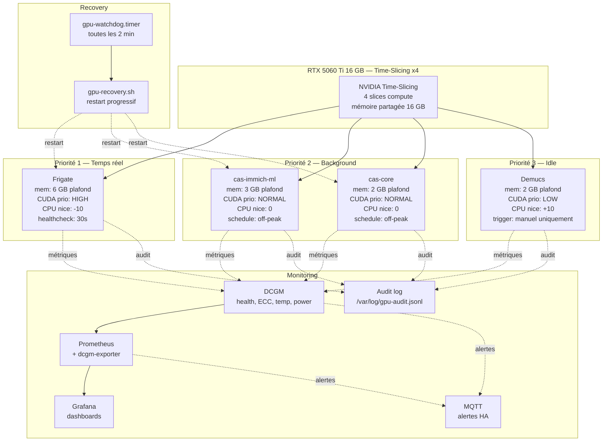

# Plan — Gestion partagée du GPU Calypso (RTX 5060 Ti 16 GB)

> **Statut** : brouillon pour revue
> **Date** : 2026-10-10
> **Auteur** : Zoo (mode Architect)
> **Contexte** : incident 2026-10-10 — wedging GPU causé par 5 workloads concurrents (Frigate, Immich ML, cas-core, Demucs, GNOME compositor)

---

## 1. Contexte et diagnostic

### 1.1 État actuel

Calypso héberge **5 workloads** qui se disputent un seul GPU (RTX 5060 Ti, 16 GB, driver 570+, **pas de support MIG** car GPU grand public) :

| Workload | Criticité | GPU mem estimée | Comportement actuel |
|---|---|---|---|
| **Frigate** (TRT, 3 caméras) | **P1 — temps réel** | ~4–6 GB | `docker-compose.calypso.yml`, `frigate-stack.service` |
| **cas-immich-ml** (CLIP embeddings) | P2 — background | ~2–4 GB | conteneur séparé |
| **cas-core** (OCR) | P2 — background | ~1–2 GB | conteneur séparé |
| **Demucs** (séparation audio) | P3 — idle | ~2–4 GB | batch manuel |
| **gnome-shell** (compositeur) | P0 — inutile | ~0.5 GB | session GDM locale |

### 1.2 Cause racine de l'incident

```
[Demucs ou Immich ML batch nuit]
    └─► CUDA error path (commande queue dans un état invalide)
        └─► GPU command queue WEDGED
            └─► Tous les cuInit() suivants échouent
                ├─► Frigate : plus de détection
                ├─► Immich ML : embeddings échouent
                └─► gnome-shell : rendu écran échoue → session gelée
                    └─► nvidia_drm ne peut pas être unload (refcount > 0)
                        └─► Recovery impossible sans reboot
```

**Le vrai problème** : aucun mécanisme n'a détecté le wedging **avant** qu'il ne devienne irréversible. Le watchdog actuel ne vérifie que `bring-up.sh`, pas la santé du GPU lui-même.

### 1.3 Contraintes matérielles

- **Pas de MIG** (Multi-Instance GPU) — réservé aux A100/H100
- **Pas de vGPU** — nécessite GPU datacenter + licence
- **Time-slicing NVIDIA** : disponible (Ampere+), partage le **compute** mais pas la **mémoire**
- **CUDA MPS** : disponible, permet des priorités au niveau thread, mais **mono-utilisateur** uniquement
- **16 GB total** : budget mémoire très serré pour 4 workloads ML

---

## 2. Objectifs

| # | Objectif | Mesure de succès |
|---|---|---|
| O1 | **Frigate ne perd jamais une frame** à cause d'un autre workload | `detection_fps > 0` 99.9 % du temps |
| O2 | **Aucun wedging GPU non détecté** pendant > 2 min | alerte MQTT < 2 min après le premier échec CUDA |
| O3 | **Recovery automatique** sans intervention humaine dans 90 % des cas | `bring-up.sh` exit 0 après auto-restart |
| O4 | **Traçabilité complète** : qui utilise quoi, quand, combien | audit log JSON par workload, retention 90 j |
| O5 | **Pas de contention mémoire** : chaque workload a un budget plafonné | OOM kill = 0/mois |
| O6 | **GNOME n'utilise plus le GPU** (cause aggravante de l'incident) | `nvidia-smi pmon` ne montre jamais gnome-shell |

---

## 3. Architecture proposée

### 3.1 Vue d'ensemble



### 3.2 Décisions techniques clés

| Décision | Rationale | Alternative rejetée |
|---|---|---|
| **Time-slicing x4** | Permet 4 processus CUDA concurrents sans file d'attente | Slicing x8 = overhead trop élevé |
| **Pas de CUDA MPS** | Mono-utilisateur, complexe à configurer跨 conteneurs | MPS ajouterait de la complexité sans bénéfice clair avec time-slicing |
| **Mémoire plafonnée par conteneur** | Évite qu'un workload mange les 16 GB | Pas de limite = OOM garanti |
| **systemd unit par workload** | Permet `Nice=`, `IOSchedulingClass=`, `CPUQuota=` | docker-compose seul ne suffit pas |
| **DCGM + Prometheus** | Standard industriel, dashboards riches | nvidia-smi seul = pas d'historique |
| **Audit log JSON** | Traçabilité fine, parseable, retention configurable | Logs texte = pas de métriques exploitables |
| **GNOME sans GPU** | Élimine la cause aggravante de l'incident | Garder GNOME = risque récurrent |

---

## 4. Phases d'implémentation

### Phase 0 — Stabilisation immédiate (aujourd'hui)

**Objectif** : éviter que l'incident se reproduise avant la fin du week-end.

- [ ] **Désactiver l'accélération GPU de GNOME**
  - `sudo systemctl set-default multi-user.target` (boot en TTY)
  - Garder `sudo systemctl start gdm` pour démarrer le desktop à la demande
  - Vérifier : `nvidia-smi pmon` ne montre plus gnome-shell
- [ ] **Créer [`gpu-recovery.sh`](../frigate-cleanup.sh:1)** (style aligné sur [`frigate-cleanup.sh`](../frigate-cleanup.sh:1))
  - Séquence : stop conteneurs → rmmod nvidia_* → modprobe → restart Frigate d'abord → autres
  - Mode `--dry-run` par défaut, `--apply` pour exécuter
  - Log dans `/var/log/gpu-recovery.log` + MQTT `calypso_frigate/maintenance/gpu-recovery`
- [ ] **Étendre [`frigate-stack-watchdog.service`](../frigate-stack-watchdog.service:1)** pour vérifier la santé GPU
  - Ajouter `nvidia-smi -q -d HEALTH` au début de `bring-up.sh`
  - Si ECC errors > 0 ou temperature > 85°C → déclencher `gpu-recovery.sh --apply`

### Phase 1 — Partage GPU + isolation mémoire (cette semaine)

**Objectif** : permettre aux 4 workloads ML de coexister sans se marcher dessus.

- [ ] **Activer NVIDIA time-slicing**
  - `sudo nvidia-ctk runtime configure --runtime=docker --set-as-default`
  - `sudo nvidia-ctk config --set nvidia-container-runtime.modes.gpu.time-slicing.slices-per-device=4`
  - `sudo systemctl restart docker`
  - Vérifier : `nvidia-smi -q | grep "Compute Mode"` doit montrer `TIME_SLICED`
- [ ] **Plafonner la mémoire GPU par conteneur** dans [`docker-compose.calypso.yml`](../docker-compose.calypso.yml:1)
  - Frigate : `NVIDIA_DRIVER_CAPABILITIES=compute,utility` + `CUDA_VISIBLE_DEVICES=0` + mem limit via `nvidia-smi -lmc` (lock memory clocks) ou cgroups
  - Approche pragmatique : utiliser `CUDA_MEMPOOL_SIZE` ou wrapper script qui appelle `nvidia-smi -lmc` avant le démarrage
  - Alternative : `docker run --gpus '"capabilities=compute,utility","device=0"'` avec `--memory-swappiness=0`
- [ ] **Créer des systemd units par workload** (en plus de docker-compose)
  - [`frigate-stack.service`](../frigate-stack.service:1) existe déjà — ajouter `Nice=-10`, `IOSchedulingClass=realtime`
  - Créer `cas-immich-ml.service`, `cas-core.service`, `demucs.service` avec `Nice=0`, `Nice=+10`
  - `After=frigate-stack.service` pour les P2/P3 (démarrage après Frigate)
- [ ] **Wrapper de démarrage** qui vérifie la mémoire GPU disponible avant de lancer un workload P2/P3
  - Si `nvidia-smi --query-gpu=memory.free --format=csv,noheader,nounits` < 2 GB → refuse de démarrer
  - Log + MQTT : "refused start: insufficient GPU memory"

### Phase 2 — Monitoring & observabilité (semaine prochaine)

**Objectif** : voir ce qui se passe en temps réel et historiquement.

- [ ] **Installer DCGM** (Data Center GPU Manager)
  - `sudo apt install datacenter-gpu-manager` (ou via NVIDIA NGC)
  - `sudo systemctl enable --now nvidia-dcgm`
  - Activer les health checks : ECC, PCIe, memory, SM, power
- [ ] **Déployer Prometheus + dcgm-exporter**
  - Ajouter `prometheus` et `dcgm-exporter` au `docker-compose.calypso.yml`
  - Scrape interval : 15s
  - Retention : 30 jours
- [ ] **Déployer Grafana** avec dashboards préconfigurés
  - Dashboard 1 : GPU overview (util, mem, temp, power) par workload
  - Dashboard 2 : Frigate detection_fps vs GPU contention
  - Dashboard 3 : Historique des incidents (wedges, OOM, restarts)
- [ ] **Alertes MQTT vers Home Assistant**
  - Topic : `calypso_frigate/maintenance/gpu-alerts`
  - Seuils :
    - `gpu_temp > 85°C` → WARN
    - `gpu_temp > 90°C` → CRITICAL → throttle P2/P3
    - `ecc_errors > 0` → CRITICAL → gpu-recovery.sh
    - `memory_free < 1 GB` → WARN → pause P3
    - `detection_fps == 0 for 60s` → CRITICAL → restart Frigate

### Phase 3 — Traçabilité & audit (semaine 2)

**Objectif** : savoir qui a utilisé quoi, quand, pourquoi.

- [ ] **Audit log JSON** : `/var/log/gpu-audit.jsonl`
  - Chaque événement (start, stop, OOM, ECC, throttle) écrit une ligne JSON
  - Champs : `ts`, `workload`, `event`, `gpu_mem_used_mb`, `gpu_util_pct`, `pid`, `container_id`
  - Rotation : logrotate, retention 90 jours
- [ ] **Wrapper `gpu-usage-logger.sh`** appelé par chaque systemd unit
  - `ExecStartPre=/usr/local/bin/gpu-usage-logger.sh start <workload>`
  - `ExecStopPost=/usr/local/bin/gpu-usage-logger.sh stop <workload>`
- [ ] **Dashboard Grafana "Audit"** : timeline des workloads sur le GPU
  - Voir qui était actif quand un incident s'est produit
  - Corrélation avec les métriques DCGM

### Phase 4 — Scheduling intelligent (semaine 3)

**Objectif** : éviter la contention en décalant les charges non urgentes.

- [ ] **Timers systemd pour P2/P3**
  - `cas-immich-ml.timer` : actif 02:00–06:00 et 14:00–16:00 (hors heures de pointe Frigate)
  - `cas-core.timer` : idem
  - `demucs.timer` : désactivé par défaut, trigger manuel uniquement
- [ ] **Throttle dynamique** basé sur la charge Frigate
  - Si `frigate_detection_fps > 25` → P2/P3 à 50 % de leur quota CPU
  - Si `frigate_detection_fps > 28` → P2/P3 pausés
  - Implémentation : script `gpu-throttle.sh` appelé par le watchdog toutes les 2 min
- [ ] **API de contrôle** (optionnel)
  - Endpoint HTTP local pour démarrer/pauser un workload à la demande
  - Intégration HA via `rest_command` ou `shell_command`

---

## 5. Monitoring — détails techniques

### 5.1 Métriques DCGM à collecter

| Métrique | Seuil WARN | Seuil CRITICAL | Action |
|---|---|---|---|
| `DCGM_FI_DEV_GPU_UTIL` | > 95 % sustained 5 min | > 99 % sustained 10 min | Throttle P2/P3 |
| `DCGM_FI_DEV_GPU_TEMP` | > 80°C | > 88°C | Pause P3, alerte |
| `DCGM_FI_DEV_POWER_USAGE` | > 250W sustained | > 280W | Throttle P2/P3 |
| `DCGM_FI_DEV_ECC_DBE_AGGREGATE` | > 0 | > 10 | gpu-recovery.sh |
| `DCGM_FI_DEV_FB_USED` / `FB_FREE` | free < 2 GB | free < 1 GB | Pause P3 |
| `DCGM_FI_DEV_SM_CLOCK` | < 1000 MHz (throttling) | < 500 MHz | Alerte + investigation |
| `DCGM_FI_DEV_RETIRED_PAGES` | > 0 | > 5 | gpu-recovery.sh |

### 5.2 Corrélation Frigate ↔ GPU

Le but est de prouver (ou infirmer) que les chutes de `detection_fps` sont corrélées à la contention GPU :

```promql
# Corrélation dans Grafana
rate(frigate_detection_fps[5m])
  vs
sum by (workload) (rate(dcgm_gpu_util_pct[5m]))
```

Si la corrélation est forte (> 0.7), on peut automatiser le throttle. Sinon, le problème est ailleurs (réseau, caméra, etc.).

### 5.3 Alertes MQTT — schéma JSON

```json
{
  "ts": "2026-10-10T18:05:23Z",
  "level": "critical",
  "category": "gpu_health",
  "metric": "ecc_dbe_aggregate",
  "value": 12,
  "threshold": 10,
  "workload": "frigate",
  "action_taken": "gpu-recovery.sh --apply",
  "recovery_status": "success",
  "duration_s": 47
}
```

HA peut ensuite déclencher des notifications (Telegram, email, etc.) ou des automatisations.

---

## 6. Traçabilité — format d'audit

### 6.1 Schéma de `/var/log/gpu-audit.jsonl`

```json
{"ts":"2026-10-10T18:00:00+02:00","workload":"frigate","event":"start","pid":1234,"container_id":"abc123","gpu_mem_used_mb":4200,"gpu_util_pct":0}
{"ts":"2026-10-10T18:00:30+02:00","workload":"frigate","event":"heartbeat","pid":1234,"gpu_mem_used_mb":4800,"gpu_util_pct":72}
{"ts":"2026-10-10T18:05:00+02:00","workload":"cas-immich-ml","event":"start","pid":5678,"container_id":"def456","gpu_mem_used_mb":2100,"gpu_util_pct":0}
{"ts":"2026-10-10T18:05:23+02:00","workload":"frigate","event":"throttle","reason":"gpu_util>95%","action":"pause_p2_p3"}
{"ts":"2026-10-10T18:06:10+02:00","workload":"frigate","event":"stop","pid":1234,"reason":"oom_killed","gpu_mem_used_mb":6200}
```

### 6.2 Requêtes utiles

```bash
# Qui utilisait le GPU au moment de l'incident ?
jq 'select(.ts >= "2026-10-10T18:00" and .ts <= "2026-10-10T18:10")' /var/log/gpu-audit.jsonl

# Combien de temps chaque workload a tourné ce mois-ci ?
jq -r 'select(.event=="start") | .workload' /var/log/gpu-audit.jsonl | sort | uniq -c

# Tous les événements OOM
jq 'select(.event=="oom_killed" or .reason=="oom")' /var/log/gpu-audit.jsonl
```

---

## 7. Procédure de recovery

### 7.1 Recovery automatique (watchdog)

Le [`frigate-stack-watchdog.timer`](../frigate-stack-watchdog.timer:1) tourne toutes les 5 min. On le complète avec un **GPU watchdog** dédié toutes les 2 min :

```bash
# /usr/local/bin/gpu-watchdog.sh
1. nvidia-smi -q -d HEALTH > /tmp/gpu-health.json
2. Si ECC errors > 0 OU temp > 90°C OU util stuck at 100% > 10 min :
   a. mosquitto_pub alerte CRITICAL
   b. docker stop frigate cas-immich-ml cas-core demucs
   c. loginctl terminate-user gdm (si gdm actif)
   d. rmmod nvidia_drm nvidia_modeset nvidia nvidia_uvm
   e. modprobe nvidia nvidia-uvm nvidia-modeset nvidia-uvm-tools
   f. docker start frigate (priorité)
   g. sleep 30 && docker start cas-immich-ml cas-core
   h. mosquitto_pub alerte RECOVERED
3. Si memory_free < 1 GB :
   a. mosquitto_pub alerte WARN
   b. docker pause demucs (si actif)
4. Logger dans /var/log/gpu-audit.jsonl
```

### 7.2 Recovery manuelle

Si l'auto-recovery échoue 3 fois de suite :

```bash
# 1. Diagnostic
nvidia-smi -q -d HEALTH
nvidia-smi pmon -c 1
journalctl -u frigate-stack-watchdog --since "1 hour ago"

# 2. Recovery manuel (depuis VS Code remote = SSH, pas besoin de TTY)
sudo systemctl stop gdm
sudo docker stop frigate cas-immich-ml cas-core cas-immich-server
sudo rmmod nvidia_drm nvidia_modeset nvidia nvidia_uvm
sudo modprobe nvidia nvidia-uvm nvidia-modeset nvidia-uvm-tools
sudo nvidia-smi  # vérifier

# 3. Restart progressif
sudo docker start frigate
sleep 30 && curl -fsS http://localhost:5000/api/version
sudo docker start cas-immich-ml
sudo docker start cas-core
sudo docker start cas-immich-server

# 4. Si rmmod échoue : reboot
sudo reboot
```

---

## 8. Maintenance long terme

### 8.1 Tâches récurrentes

| Fréquence | Tâche | Outil |
|---|---|---|
| Quotidien | Vérifier les alertes MQTT de la veille | HA + Grafana |
| Hebdomadaire | Examiner les métriques DCGM (tendances temp, ECC) | Grafana |
| Mensuel | Analyser l'audit log (qui a utilisé quoi, quand) | `jq` + Grafana |
| Trimestriel | Calibrer les seuils d'alerte selon l'usage réel | Grafana + retour d'expérience |
| Annuel | Mettre à jour le driver NVIDIA + DCGM | `apt upgrade` |

### 8.2 Métriques de succès (KPIs)

- **Disponibilité Frigate** : `detection_fps > 0` 99.9 % du temps → cible
- **Incidents GPU** : < 1/mois non détectés → cible
- **Recovery auto** : > 90 % des incidents résolus sans intervention → cible
- **Contention mémoire** : 0 OOM kill/mois → cible
- **Traçabilité** : 100 % des événements GPU loggés → cible

### 8.3 Évolution future

Si la contention devient ingérable :
- **Option A** : Ajouter un second GPU (RTX 3060 12 GB d'occasion, ~150 €) dédié à Immich/cas-core/Demucs
- **Option B** : Migrer Demucs sur CPU (acceptable pour des batches occasionnels)
- **Option C** : Migrer Immich ML sur une machine séparée (Raspberry Pi + Coral TPU)

---

## 9. Risques et mitigations

| Risque | Probabilité | Impact | Mitigation |
|---|---|---|---|
| Time-slicing dégrade les perfs Frigate | Moyenne | Moyen | Benchmark avant/après, rollback possible |
| DCGM consomme trop de CPU | Faible | Faible | Scrape interval 30s au lieu de 15s si nécessaire |
| Prometheus remplit le disque | Moyenne | Moyen | Retention 30j, monitoring du disk usage |
| Audit log trop volumineux | Faible | Faible | Rotation logrotate, compression gzip |
| GNOME sans GPU = 불편 pour l'utilisateur | Faible | Faible | `sudo systemctl start gdm` à la demande |
| Recovery auto échoue et reboot en boucle | Faible | Élevé | Cap à 3 reboots/h, alerte CRITICAL |

---

## 10. Checklist de validation

Avant de considérer le plan comme terminé :

- [ ] L'utilisateur a validé les priorités (Frigate > Immich/cas-core > Demucs)
- [ ] L'utilisateur a validé le budget mémoire par workload
- [ ] L'utilisateur a validé les heures off-peak pour P2/P3
- [ ] L'utilisateur a accès à un dashboard Grafana (ou veut que je le déploie)
- [ ] L'utilisateur a confirmé que GNOME peut être désactivé au boot
- [ ] Les seuils d'alerte sont calibrés selon l'usage réel (pas juste théoriques)

---

## 11. Prochaines étapes

1. **Revue utilisateur** : valider ce plan, ajuster les priorités et les seuils
2. **Phase 0** : stabilisation immédiate (désactiver GNOME GPU, gpu-recovery.sh, watchdog étendu)
3. **Phase 1** : time-slicing + memory limits + systemd units
4. **Phase 2** : DCGM + Prometheus + Grafana + alertes MQTT
5. **Phase 3** : audit log + dashboards
6. **Phase 4** : scheduling intelligent + throttle dynamique

Chaque phase est **indépendante** et peut être livrée séparément. Les phases 0 et 1 sont les plus critiques pour éviter un nouvel incident.
